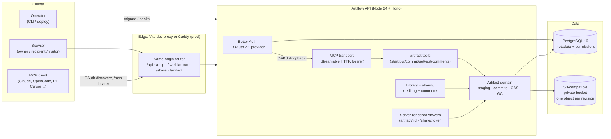
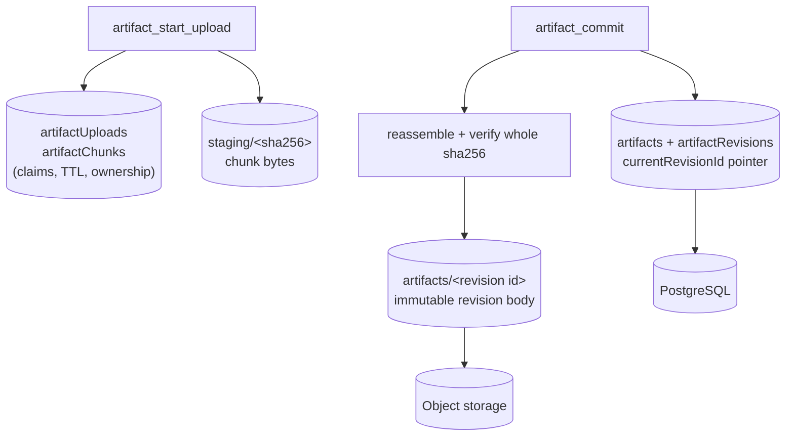

# Architecture overview

**Status:** migration target approved; implementation pending. **Date:** 2026-11-10.

Artiflow is a self-hosted library where MCP agents publish HTML artifacts and
markdown documents, and people manage access from a browser. It is a **modular
monolith**: one repository, one PostgreSQL database, one codebase for the API,
and two deployable containers in production. There is deliberately no microservice
split, no message broker, and no external identity provider.

Harness-side integration (per-harness plugins, MCP Apps inline viewer, instance
configuration for self-hosted deployments) is specified in
[harness-plugins.md](harness-plugins.md). That document includes future work, not
packages already delivered. The [target module map](modules.md#target-workspace)
defines where new code belongs; the numbered sections below describe the current
implementation until each migration step updates them.

## Multi-surface architecture decision

**Status:** accepted target, incrementally implemented. **Date:** 2026-11-10.

Keep one core API and one database. Separate deployable applications and reusable
packages by consumption boundary, not by the number of files. Four consumers
exist in the product model: dashboard, MCP hosts, harness plugins, and third-party
HTTP/SDK clients. The public application boundary is `/api/v1`; clients must not
import API internals or reach its database/storage directly.

| Decision                 | Adopted approach                                                                                |
| ------------------------ | ----------------------------------------------------------------------------------------------- |
| Runtime and installation | Bun runs the API (development and production) and is the only package manager; one root install |
| Orchestration            | `bun run` scripts; no Turborepo for this migration                                              |
| Contracts                | Shared Zod schemas and inferred wire types; real-app/real-parser contract tests                 |
| Client                   | Hand-written fetch SDK with injectable fetch and token provider; no client generator or Effect  |
| Shared domain            | Pure anchors/Markdown helpers; no Hono, persistence, auth or browser UI                         |
| Testing                  | Keep the existing Node suite in root `test/`; update paths without rewriting source-tests       |
| Decisions                | Keep status, date and rationale in this architecture directory, not `docs/decisions/`           |
| Compatibility            | One coordinated rename of `ARTIFLOW_*`, `ui://artiflow/...` and the plugin package name         |

### Current versus target

Today the root package owns `apps/api` and its dependencies; the dashboard lives in `apps/dashboard` and shared pure helpers in `packages/domain`. The
OpenCode plugin has a separate installation and lockfile. HTTP DTOs are duplicated
between handlers and browser parsers. Production serves the dashboard through
Caddy, not through the Node process.

This migration introduces `apps/api`, `apps/dashboard`, `packages/contracts`,
`packages/domain` and `packages/sdk`. Plugin enrollment was proven by clean
install (job evidence: regenerating the root lock with the plugin enrolled, npm
ci clean, plugin suites green) and `plugins/opencode` is now a workspace with a
single root lockfile. The mock marketing landing under `site/` has been removed;
its replacement is one future web workspace publishing the site and docs at
`artiflow.dev/docs`, planned and not implemented in this migration.

`/api/v1` is the public bearer-only API surface (delivered 2026-11-10):
the same OAuth 2.1 provider from the MCP flow, with `/api/v1` as a second
protected resource. Four scopes — `artifacts:read`, `artifacts:write`,
`comments:write`, `shares:manage` — gate every request through one scope table
(`apps/api/src/routes/v1/scopes.ts`); artifact creation stays MCP-only.
Bearer requests never fall back to the cookie session and
skip the cookie CSRF guard (browsers cannot hold a bearer token); the dashboard
keeps cookie sessions untouched. Registration is opt-in: dynamic client
registration never default-links the API resource, the client declares it. SDK
holding the token: `@artiflow/sdk` (`createSdkAuth` + `createSdkClient` with
`apiPrefix: "/api/v1"`).
Versioned API errors use `{ code, status, requestId }`; unknown failures must be
sanitized 500 responses, never inferred conflicts. Unknown artifact kinds fall
back to an inert representation, never executable HTML.

### Deployment topologies

| Topology                | Current support                                                                     | Target and limits                                                                                                                                                                             |
| ----------------------- | ----------------------------------------------------------------------------------- | --------------------------------------------------------------------------------------------------------------------------------------------------------------------------------------------- |
| **A — self-hosted**     | Caddy serves the SPA and proxies to Node; one-shot migrator; external PostgreSQL/S3 | Same logical application. A single Node process serving a dashboard build and embedded MCP is a future packaging option, not a deployment change in this migration.                           |
| **B — split/cloud**     | Separate web/API containers behind one origin                                       | Dashboard on CDN and API at a separate origin is a future topology; cross-origin auth/CORS and standalone MCP are not implemented here. The SDK supports injected fetch or network transport. |
| **C — harness plugins** | OpenCode runs outside the API and speaks MCP                                        | Plugins remain external. Future SDK-based plugins/connectors must use the public API, never API internals. No new plugin or connector is created here.                                        |

Embedded MCP remains in the API and shares application use cases with HTTP; the tool logic itself lives in packages/mcp-server behind the McpBackend port, with the standalone entrypoint deferred. A
standalone MCP entrypoint, `mcp-server`, `mcp-apps`, `plugin-core`, shared UI and
additional plugins are future boundaries, not empty workspaces to create now.
Pagination, releases, database changes and upload/CAS/GC invariant changes are
also outside this migration.

The dependency allowlist, package exports and CI boundary check are described in
[modules](modules.md#target-dependency-rules). The implementation order is
documentation → dashboard → plugin installation gate → shared packages → API →
contracts/SDK/v1 gate → HTTP/internal layering. Each move carries its necessary
Docker, tooling, test and documentation path updates, without functional refactors.

## 1. What the system does

Three jobs, in order of importance:

1. **Receive content from agents.** Agents authenticate with OAuth 2.1, upload
   bytes through MCP tools in bounded chunks, and commit an immutable revision.
2. **Deliver content safely.** Owners and granted recipients open a sandboxed
   viewer; public links serve the same bytes without a session.
3. **Let humans manage it.** Sign in, list, share, publish links, edit markdown,
   comment on selections, restore versions, delete.

Artifact bytes never touch PostgreSQL. PostgreSQL holds metadata and permissions;
object storage holds the bytes, addressed by their SHA-256.

## 2. Deployable units

| Unit               | Path               | Runtime                                                | Responsibility                                                                  |
| ------------------ | ------------------ | ------------------------------------------------------ | ------------------------------------------------------------------------------- |
| **API**            | `src/api`          | Node 24 executing TypeScript directly (type stripping) | HTTP surfaces, MCP, OAuth, persistence, object storage, server-rendered viewers |
| **Web app**        | `apps/dashboard`   | React 19 SPA built by Vite                             | Library, editor, auth/consent screens, account and connect pages                |
| **Edge (prod)**    | `docker/Caddyfile` | Caddy 2                                                | TLS, static SPA serving, reverse proxy to the API                               |
| **Database**       | external           | PostgreSQL 16                                          | Auth, OAuth, artifact metadata, shares, links, comments                         |
| **Object storage** | external           | S3-compatible (R2, S3, MinIO, Ceph, …)                 | Immutable staging chunks and revision bodies                                    |

In production `docker-compose.prod.yml` runs three services: `migrate` (one-shot),
`api`, and `web` (Caddy + SPA). Local development runs the API and
the Vite dev server on the host against external PostgreSQL and S3-compatible
services.

## 3. High-level diagram



The web SPA talks only to the API on its own origin. In development the Vite proxy
provides that origin; in production Caddy does.

## 4. Layering

The code is organised by responsibility, not by framework convention:

```
Edge (proxy / TLS)
  └─ HTTP adapters          apps/api/src/server.ts mounts one Hono app per surface
      ├─ auth.ts            Better Auth handler + cookie CSRF guard
      ├─ mcp.ts             bearer-only transport
      ├─ library.ts         owner reads, artifact viewer, delete
      ├─ sharing.ts         grants, public links, public viewer
      ├─ editing.ts         markdown autosave, history, restore
      └─ comments.ts        anchored comment threads
  └─ Application services   artifacts/commit-flow.ts, deletion.ts, artifacts/gc.ts
      └─ Domain repositories artifacts/staging.ts, artifacts/commits.ts,
                             artifacts/s3.ts, artifacts/markdown.ts
          └─ Persistence     db/client.ts, db/*schema.ts, storage/client.ts
```

`server.ts` is the composition root: it loads config once, creates the database
pool, the S3 client and the Better Auth instance, then mounts apps in a
deliberately ordered sequence. Dependencies are injected through option objects;
there is no service locator and no global state.

### Where the layering is not uniform

Some HTTP adapters (`library.ts`, `sharing.ts`, `editing.ts`, `comments.ts`) issue
SQL directly. The MCP tool layer (`artifact-tools.ts`) also issues SQL for
comments and reads. These two transports therefore duplicate a few queries and
guards. This is the main architectural inconsistency in the codebase and is
recorded as an improvement. The persistence split (Drizzle for auth/migrations,
raw `pg` for product tables) is being unified.

## 5. Request routing

| Url                                                                        | Served by | Notes                                                             |
| -------------------------------------------------------------------------- | --------- | ----------------------------------------------------------------- |
| `/`, `/library`, `/edit/:id`, `/login`, `/consent`, `/connect`, `/account` | SPA       | Manual pathname routing in `apps/dashboard/src/main.tsx`          |
| `/artifact/:id`                                                            | API       | Owner/recipient server-rendered viewer (not the SPA)              |
| `/share/:token`                                                            | API       | Session-free public viewer                                        |
| `/api/health`                                                              | API       | PostgreSQL + storage probes                                       |
| `/api/auth/*`                                                              | API       | Better Auth handler, cookie-guarded mutations                     |
| `/.well-known/oauth-*`                                                     | API       | OAuth discovery (GET/HEAD)                                        |
| `/mcp`                                                                     | API       | Bearer-only MCP, POST only                                        |
| `/api/artifacts*`                                                          | API       | Cookie session, owner-scoped                                      |
| `/api/v1/*`                                                                | API       | Bearer only (api/v1 OAuth resource, 4 scopes, no cookie fallback) |
| `/share /artifact /.well-known /mcp /api`                                  | Proxy     | Vite dev proxy and Caddy both route these to the API              |

The proxy contract exists twice on purpose: `vite.config.ts` for development and
`docker/Caddyfile` for production. Both must stay in sync.

## 6. Data planes



- **Control plane:** PostgreSQL. Ownership, permissions, revisions metadata, CAS
  pointers, grants, public-link hashes, comments.
- **Data plane:** object storage. Chunk bytes under `staging/<sha256>`, revision
  bodies under one key per revision (`artifacts/<revision id>`, generated before the
  put and never reused). The key does not name the digest, so every read re-hashes
  the returned bytes and compares them with the revision row's `sha256`.
- **Transactions never span both.** A commit writes bytes first, then metadata; a
  storage failure leaves bytes no row names, and the daily revision sweep removes
  them once they are older than its 24-hour grace window.

## 7. Security model (summary)

The invariant list is below.

| Surface         | Identity                                | Guard                                                                                                            |
| --------------- | --------------------------------------- | ---------------------------------------------------------------------------------------------------------------- |
| Browser API     | HttpOnly session cookie                 | Exact `Origin` + JSON on every mutation; `SameSite=Lax`, `Path=/`, `Secure` in production/HTTPS; no cookie cache |
| MCP             | OAuth bearer JWT                        | Audience-bound token (`<origin>/mcp`), per-tool scope check, exact `Host`/`Origin` allowlist, no cookie accepted |
| OAuth protocol  | Client credentials / PKCE               | `resource` required at authorize; DCR public clients only; consent is the human gate                             |
| Artifact viewer | Session (owner/recipient) or link token | Permission predicate before any byte read; bytes escaped into `srcdoc` of an opaque-origin iframe                |
| Public link     | 32-byte random token                    | Only `sha256(token)` stored; no expiry by design; rotation revokes predecessor                                   |
| Storage         | S3 credentials                          | Private bucket, no ACL/policy, no public route                                                                   |

Artifact bytes never execute on the application origin. HTML is escaped with
`& < > " '`, placed in `srcdoc` on a trusted page, and framed with
`sandbox="allow-scripts"` and `default-src 'none'`. Markdown is rendered with
`html:false` and framed with `sandbox=""`. The served page adds one directive,
`connect-src 'self'`, for its own freshness poll: the artifact frame inherits that list but keeps its
opaque origin, so its requests carry no cookies and it cannot reach the parent page.

## 8. Technology summary

| Area                  | Choice                                                                                                |
| --------------------- | ----------------------------------------------------------------------------------------------------- |
| Language              | TypeScript 5.9 strict, `noUncheckedIndexedAccess`, `erasableSyntaxOnly` (Bun runs API `.ts` directly) |
| API                   | Hono 4.13 + `@hono/node-server` 2.1                                                                   |
| Auth                  | Better Auth 1.7.10 + `@better-auth/mcp` (OAuth provider + JWT)                                        |
| MCP                   | Official `@modelcontextprotocol/sdk` 1.32, Streamable HTTP, stateless                                 |
| Database              | PostgreSQL 16 + Drizzle ORM 0.45 / drizzle-kit 0.31 + `pg`                                            |
| Storage               | `@aws-sdk/client-s3` 3.1152 (any private S3-compatible bucket)                                        |
| Web                   | React 19.3, Vite 7.3, Tailwind 4.3, Radix UI, TipTap 3.32, markdown-it 15                             |
| Server-rendered pages | Hand-built HTML/CSS in TypeScript (`viewer-html.ts`, `viewer-markdown.ts`)                            |
| Deployment            | Docker Compose; Bun 1.3.10 image for the API; Caddy 2 image                                           |
| Tests                 | Node built-in test runner (`node --test`), real HTTP/PostgreSQL/S3 integration suites                 |

## 9. Design principles visible in the code

1. **Fail closed** — ownership failures, invalid shapes under/over caps and missing
   config all refuse rather than guess.
2. **One source of truth per rule** — the read predicate, the viewer wrapper, the
   size caps and the migration guard are each defined once.
3. **Immutable history** — revisions are appended, never rewritten; restore
   appends a new revision.
4. **Verify bytes at the edges** — the server hashes what it receives and what it
   reads; client-declared digests are verified, never trusted.
5. **Bounded work** — 16 MiB artifact cap, 1 MiB chunk cap, 60-minute staging TTL,
   list limits, 4 DB connections per API process.
6. **Explain the boundary** — long comments state the rejected alternative and the
   security reason, which is why this system can be audited.

## 10. Known architectural limits

These are documented, not accidental.

| Limit                                                                                                                                                      | Why it exists                                                                                                                                    |
| ---------------------------------------------------------------------------------------------------------------------------------------------------------- | ------------------------------------------------------------------------------------------------------------------------------------------------ |
| Access tokens are self-contained JWTs (900 s) and cannot be revoked before expiry. The refresh token is the revocable credential.                          | Stateless bearer verification; no per-request token lookup.                                                                                      |
| Public links have no expiry; the token is the credential.                                                                                                  | 256-bit unguessable token; revocation and rotation are the controls.                                                                             |
| Soft-deleted artifacts keep their rows and revision metadata forever; only the artifact's own revision objects are removed best effort.                    | Soft delete is the delivery gate; there is no purge job yet.                                                                                     |
| A crash between an S3 staging put and its metadata insert leaves a key with no row; the row-driven staging GC cannot see it.                               | The staging GC is metadata-driven and does not list the bucket; only the daily revision sweep lists storage, and it examines `artifacts/` alone. |
| There is no cache, queue, background worker or distributed lock. Both GC sweeps run in-process.                                                            | Single-instance topology; the sweeps are idempotent and absorbed locally.                                                                        |
| Full multi-maintainer governance and release automation are deferred. CI `verify`, Prettier/oxlint ratchet, MIT license and security policy already exist. | Preserve the existing baseline; broader governance is outside this migration.                                                                    |
