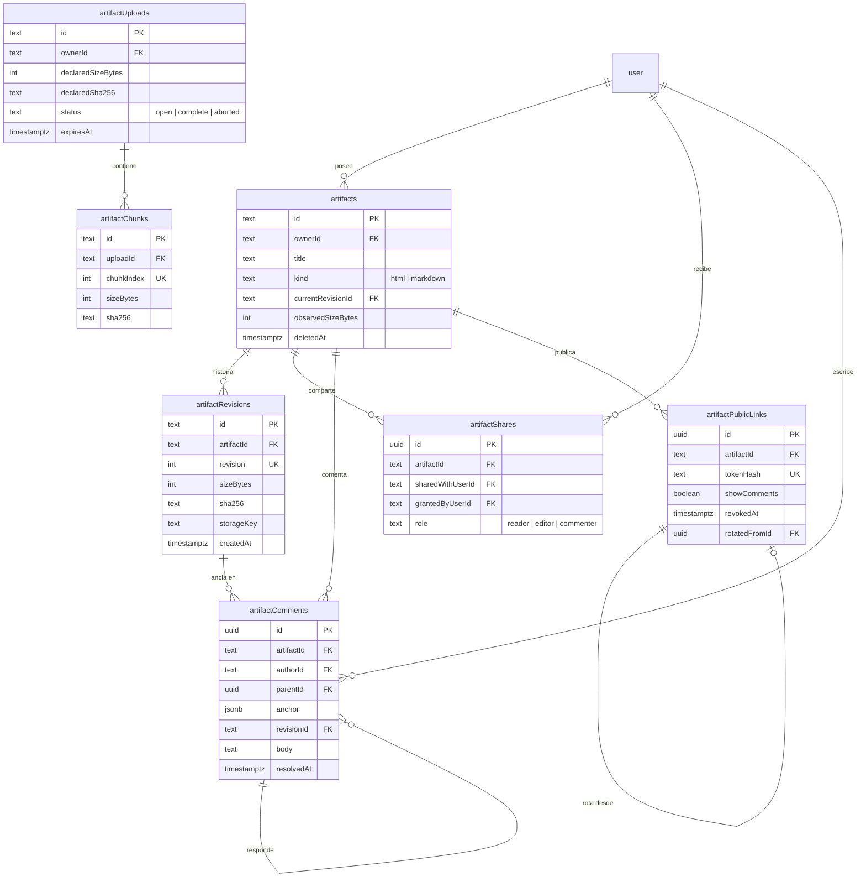
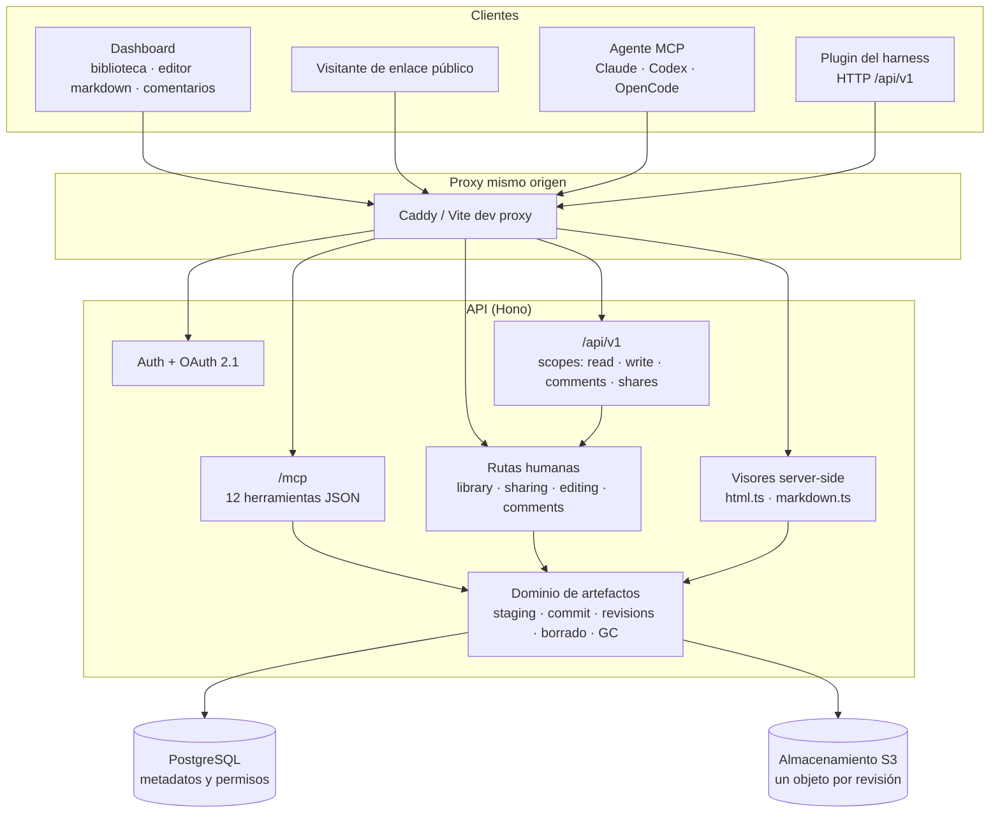
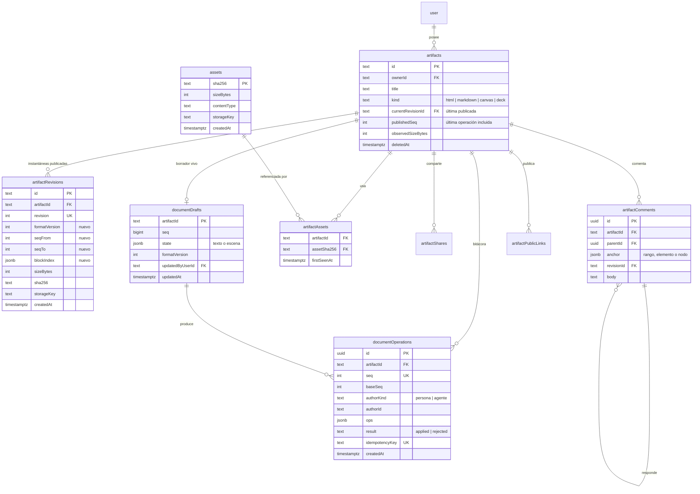
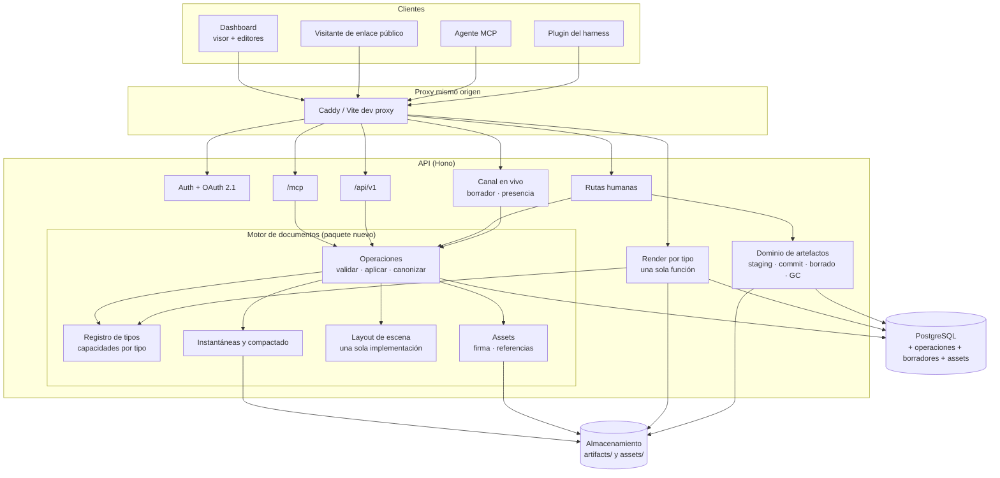
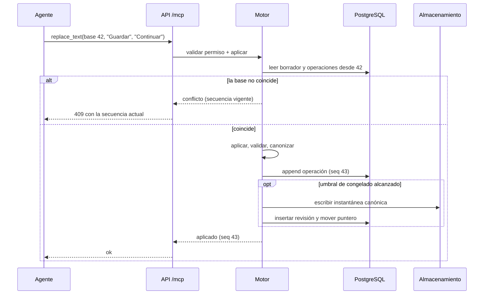

# Canvas, documentos editables y arquitectura: documento raíz

**Estado:** investigación cerrada, objetivo y plan definidos, implementación por fases.
**Fecha:** 2026-11-21. **Alcance:** este es el **documento raíz** del trabajo. Reemplaza y
absorbe las notas anteriores: diagnóstico, objetivo de producto, modelo de datos,
arquitectura, decisiones y plan están todos acá.

Los diagramas están en Mermaid y se renderizan en GitHub y en el sitio de documentación.

**Índice**

1. [Qué es Artiflow hoy](#1-qué-es-artiflow-hoy)
2. [Cómo se guarda y gestiona un artefacto hoy](#2-cómo-se-guarda-y-gestiona-un-artefacto-hoy)
3. [Modelo actual y arquitectura actual](#3-modelo-actual-y-arquitectura-actual)
4. [Por qué un canvas no entra en ese molde](#4-por-qué-un-canvas-no-entra-en-ese-molde)
5. [Las tres deudas de diseño](#5-las-tres-deudas-de-diseño)
6. [Qué enseñan los productos que ya lo resolvieron](#6-qué-enseñan-los-productos-que-ya-lo-resolvieron)
7. [Qué significa "compatible con uso basado únicamente en MCP"](#7-qué-significa-compatible-con-uso-basado-únicamente-en-mcp)
8. [Objetivo de producto](#8-objetivo-de-producto)
9. [Objetivo: modelo de datos](#9-objetivo-modelo-de-datos)
10. [Objetivo: arquitectura de la aplicación](#10-objetivo-arquitectura-de-la-aplicación)
11. [Las siete decisiones de diseño](#11-las-siete-decisiones-de-diseño)
12. [El plan, fase por fase](#12-el-plan-fase-por-fase)
13. [Cómo sabemos que llegamos](#13-cómo-sabemos-que-llegamos)
14. [Riesgos del modelo nuevo](#14-riesgos-del-modelo-nuevo)
15. [Decisiones abiertas](#15-decisiones-abiertas)
16. [Glosario](#16-glosario)

---

## 1. Qué es Artiflow hoy

Artiflow hace tres cosas, en este orden de importancia:

1. **Recibir contenido de agentes.** Un agente (Claude, Codex, OpenCode, Cursor) publica
   una página HTML o un documento Markdown y obtiene un artefacto con dueño.
2. **Entregarlo con seguridad.** El dueño, las personas invitadas y los enlaces públicos
   abren un visor. El contenido nunca ejecuta en el dominio de la aplicación.
3. **Dejar que las personas lo administren.** Biblioteca, permisos, enlaces, edición de
   Markdown, comentarios, historial, borrado.

Dos tipos de artefacto: `html` y `markdown`. Nada más.

---

## 2. Cómo se guarda y gestiona un artefacto hoy

Esta sección es la base de todo lo demás. Si el modelo no se entiende, el resto del
documento parece una opinión.

### 2.1 El viaje de una publicación

Un agente que publica pasa por estos pasos:

1. **Anuncia** cuánto va a pesar y con qué firma, y recibe un identificador de subida.
2. **Manda el contenido por partes**, en pedazos de 1 MiB como máximo.
3. **Confirma** al final. En ese momento el servidor junta las partes, **vuelve a calcular
   la firma del archivo completo** y la compara con la anunciada.
4. **Se crea una revisión**: un objeto nuevo, cerrado, en el almacenamiento.
5. La base de datos mueve el puntero "revisión actual" del artefacto hacia la nueva.
6. El visor ya muestra lo nuevo. Lo viejo sigue existiendo.

Si el agente manda algo chico (menos de 1 MiB de texto), hay un atajo: una sola llamada
que hace todo de una vez.

**Lo importante:** el servidor no guarda "el artefacto". Guarda **revisiones**, y el
artefacto es una fila que apunta a la última. Las partes de una subida son temporales: si
no se confirma en 60 minutos, se descartan.

Ese camino es correcto **para HTML**. Para Markdown tiene un costo que se explica en las
deudas: no existe "crear el documento dentro del producto", solo subir un archivo.

### 2.2 Qué es una revisión, y por qué nunca se toca

Una revisión es un archivo **inmutable**: bytes + tamaño + firma. Nunca se edita.
"Cambiar el artefacto" significa **agregar otra revisión y mover el puntero**.

Cuatro consecuencias que no son obvias:

- **No hay deduplicación.** Si subís dos veces el mismo contenido, son dos revisiones y dos
  copias en el almacenamiento. Fue una decisión deliberada.
- **Restaurar no es rebobinar.** Restaurar la revisión 3 crea la revisión 8 con el
  contenido de la 3. El historial nunca retrocede, siempre crece.
- **Cada revisión se identifica por su contenido.** Si alguien cambia un byte, es otro
  objeto, con otra firma. Eso permite detectar corrupción: el servidor vuelve a calcular
  la firma cada vez que sirve algo y se niega a servir si no coincide.
- **Cambiar una letra cuesta el documento entero.** No hay operaciones: el guardado actual
  reenvía el documento completo y crea otra copia. Con texto se paga en kilobytes; con
  cualquier documento grande, en segundos y en almacenamiento.

### 2.3 Cómo se lee un artefacto

El servidor **no sirve archivos**. Cada request de visor hace este trabajo:

1. Resolver quién sos y si podés verlo (dueño, invitado con permiso, o token de enlace
   público).
2. Leer los bytes desde el almacenamiento.
3. Verificar la firma.
4. **Construir** una página del servidor: el contenido va adentro de un marco aislado.

Por eso la URL que ves no es el archivo. Es una vista.

**Detalle técnico — el aislamiento.** El contenido se escapa y se inyecta en el atributo
`srcdoc` de un `<iframe sandbox="allow-scripts">`, con una política de contenido heredada
del padre que arranca en `default-src 'none'`. Ese marco tiene un **origen opaco**: puede
ejecutar JavaScript, pero no tiene `localStorage`, no puede pedir nada a la red, no puede
cargar imágenes ni fuentes externas. Es el precio de que un HTML de un agente nunca pueda
tocar la aplicación. Markdown tiene otro régimen: no se enmarca, se renderiza en la propia
página con HTML crudo deshabilitado, y sí puede mostrar imágenes.

**Consecuencia aritmética:** un artefacto HTML no puede mostrar imágenes externas ni embebidas como
`data:`, porque el marco solo habilita el propio origen (`img-src 'self'`) y hasta F4 no existía
ningún lugar donde alojar un binario. No es un fallo de render: es el aislamiento funcionando. Con la
llegada de la vía de assets (F4) el canvas sí muestra imágenes, y lo hace con una política que
nombra **un solo origen**, el de la instancia, nunca un tercero.

El visor del host respeta esa misma política. Cuando el agente abre un canvas o un deck en la
conversación, el visor pide el documento ya renderizado —el mismo que sirve esta página— por una
llamada proxy, y el marco que lo dibuja nombra **ese único origen** para las imágenes: el de la
instancia. Una imagen que el artefacto no posee se dibuja como marcador con su digest, nunca desde
un tercero. Si la instancia no tiene un origen utilizable, el marco no nombra ningún origen.

### 2.4 Quién puede ver y quién puede tocar

| Quién                            | Cómo se identifica                                            | Qué puede                               |
| -------------------------------- | ------------------------------------------------------------- | --------------------------------------- |
| Dueño                            | Sesión del navegador o token de agente                        | Todo                                    |
| Invitado `reader`                | Sesión del navegador                                          | Ver                                     |
| Invitado `editor`                | Sesión del navegador                                          | Ver y editar el documento               |
| Invitado `commenter`             | Sesión del navegador                                          | Ver y comentar                          |
| Cualquiera con el enlace público | Token secreto en la URL                                       | Ver (el dueño decide si ve comentarios) |
| Agente                           | Token OAuth con permisos `artifacts:read` / `artifacts:write` | Según el permiso                        |

Detalle que importa: **los agentes ven el artefacto como si fueran el dueño**. Los permisos
de invitados existen, pero el camino de los agentes los ignora.

### 2.5 Cómo se edita (y por qué solo Markdown)

Markdown se edita en el navegador. El editor guarda solo, con dos salvaguardas:

- **Si alguien más guardó mientras escribías, tu guardado se rechaza** y te avisa. No hay
  mezcla: no se fusionan dos versiones, se rechaza la que llega tarde.
- Mientras editás, el editor consulta cada tanto si hay una versión nueva, y te deja
  elegir entre quedarte con la tuya o traer la del otro.

HTML no se edita en el navegador, y por decisión de producto no se va a editar: un HTML se
reemplaza, solo lo produce un agente.

Como no hay estado vivo del lado del servidor, **no se ven las ediciones en tiempo real**:
se ve "hay una versión nueva" cada ocho segundos. Es la deuda que resuelve el borrador.

### 2.6 Cómo funcionan los comentarios

Un comentario no se guarda como "comentario en este artefacto". Se guarda **anclado a un
lugar del documento**:

- En Markdown, a un rango de texto concreto (línea y columna de origen, más el texto
  citado), así se puede detectar si el texto cambió y marcarlo como desactualizado.
- En HTML, a un elemento identificado por un selector, o a un punto de la página.

El servidor revalida el ancla contra el contenido vivo antes de aceptarla. Un ancla que ya
no corresponde se rechaza.

**`board-point` se entregó en F5 y `slide-point` sigue esperando su tipo.** El ancla nombra el marco,
el nodo y un punto **normalizado dentro del nodo**, que es lo que hacía falta: un punto suelto no
decía a qué nodo pertenecía y se despegaba en cuanto alguien movía la tarjeta. El servidor la resuelve
contra la escena viva antes de guardarla, y un hilo cuyo nodo desapareció se lista como huérfano en
vez de dibujarse en una posición vieja. `slide-point` conserva la misma forma y espera a que exista el
tipo deck.

### 2.7 Qué pasa al borrar

Se marca como borrado, se corta el acceso y se intentan borrar los objetos de sus
revisiones. Las filas de metadatos sobreviven. Además hay una limpieza diaria que recorre
el almacenamiento y borra objetos que ninguna fila reclama.

**Las tres reglas de oro del modelo actual:**

1. **El servidor desconfía de lo que le mandan** y verifica cada byte que sirve.
2. **Una revisión es un archivo cerrado**; cambiar es agregar, nunca modificar.
3. **Un artefacto es un documento entero**, sin partes con identidad propia adentro.

---

### 2.8 Artboards vivos: un frame que apunta a una página publicada

Un frame de un Diseño puede mostrar una página HTML existente en lugar de nodos propios. La
referencia vive en el frame y no copia bytes:

```json
{
  "id": "propuesta-a",
  "name": "Propuesta A",
  "x": 0,
  "y": 0,
  "w": 390,
  "h": 640,
  "nodes": [],
  "source": { "artifactId": "<página>", "revisionId": "<revisión elegida>", "mode": "fluid" }
}
```

Decisiones que sostienen la entrega:

- **La revisión está fijada.** Publicar una revisión nueva del origen no cambia el artboard. La
  actualización es explícita, por artboard: `update_frame` con el `revisionId` nuevo, desde el botón
  “Update to latest revision” del editor (confirmado, y publica el Diseño) o desde `scene_apply`.
- **El permiso se revalida al abrir el Diseño.** `apps/api/src/viewer/artboards.ts` resuelve cada
  origen con el viewer efectivo (`readableArtifactPredicate`) y devuelve `ready`, `forbidden`,
  `missing`, `not_html` o `too_large`. Vincular no escribe ACLs: quien no puede leer el origen ve
  “This proposal is not available to you.” y ningún byte. Un viewer público o anónimo nunca recibe
  contenido del origen.
- **El contenido se sirve inline, sellado y sin ampliar accesos.** `views/scene.ts` compone un
  `iframe` sandbox con `data:` (límite `ARTBOARD_MAX_INLINE_BYTES`, 1 MiB) resuelto del lado del
  servidor; leer una revisión histórica del propio Diseño es una ruta aparte (sección 2.11) que
  revalida el acceso al Diseño y nunca entrega bytes de un origen ajeno. Un documento
  `data:` no hereda la CSP del padre, así que `withDocumentPolicy` (misma `DOCUMENT_CSP` que usa la
  página HTML autónoma) inyecta el `<meta http-equiv="content-security-policy">` después del doctype
  y dentro del `<head>` cuando existe, tolerando BOM y espacios. Sin red, sin frames y sin eval: una
  página que pide recursos externos los pierde dentro del Diseño, a cambio de contenido sellado.
  Funciona igual en el visor web y en MCP Apps, donde `artifact_get_scene` resuelve para el usuario
  que pregunta.
- **Fijo o fluido.** `mode: "fixed"` dibuja la página al ancho del frame; `mode: "fluid"` la
  reacomoda en 390 o 1280 dentro de la misma caja del canvas, sin escalarla como imagen. El frame
  conserva `x/y/w/h` como geometría del canvas y no admite nodos sueltos.
- **Página autónoma intacta.** El origen mantiene su visor y su enlace; incorporarlo no lo modifica.
- **MCP.** `add_frame`/`update_frame` aceptan `source` (y `source: null` lo quita); `scene_apply`
  responde `url` con el enlace absoluto al Diseño; `scene_read` devuelve `source` y `sourceState`
  (revisión fijada, estado y última revisión). El editor dibuja el artboard como tarjeta: acomodar,
  nombrar y ordenar; la comparación en vivo ocurre en el visor del Diseño.

### 2.9 Focus, Play y navegación conectada

**Tres modos del mismo documento.** `Canvas` es la vista general; `Focus` llena la vista con un
artboard a 390 o 1280; `Play` recorre el prototipo. No son documentos distintos: el servidor solo
elige el modo inicial y el resto lo cambia el controlador del documento en la misma página, así que
volver al canvas restaura el paneo, el zoom y la selección sin guardar nada.

**El enlace profundo vive en la URL del visor.**

```
/artifact/<design>?frame=<frameId>&view=focus&width=390
/artifact/<design>?frame=<frameId>&view=play&width=1280
```

`parseSceneLink` valida `view` (`focus` o `play`), `width` (390 o 1280) y `frame` (no vacío, sin
caracteres de control, hasta 200 caracteres) en `packages/domain/src/scene-link.ts`. `planSceneView`
lo resuelve contra la escena: un `frame` que el Diseño no tiene, un `view` desconocido o un `width`
no soportado caen al canvas sin otro efecto, y `play` exige que el frame sea un artboard vivo. Las
dos rutas del visor (`/artifact/:id` y el enlace compartido `/s/:token`) usan el mismo plan, así que
el enlace de Focus y Play respeta los permisos que ya aplicaba cada ruta y un lector sin acceso al
origen sigue viendo el estado no disponible.

**Qué dibuja cada modo.** `views/scene.ts` recibe el plan y compone el documento: en `focus` el
artboard pedido lleva `data-scene-active`, la caja y el `iframe` se ajustan al ancho elegido y la
barra ofrece 390/1280 y «Back to canvas» —un artboard `fixed` conserva el ancho con el que se
escribió, porque ese es su contrato—; en `play` no se emite barra, ni nombre de frame, ni índice,
ni herramientas, ni pines, y el control de salida es el único control del contenedor. Los demás
frames siguen en el documento —ocultos— para que una conexión pueda alcanzarlos. La política y el
sandbox no cambian: `frame-src data:` solo cuando hay artboards, `sandbox="allow-scripts"` y el
documento sellado con su propio `<meta>` de CSP.

**Contrato de navegación.** El HTML sellado no puede navegar ni leer el padre, así que la conexión
es un mensaje al contenedor con vocabulario cerrado:

```js
parent.postMessage(
  { channel: "artiflow-play", version: 1, kind: "navigate", frame: "<frameId>", state: { plan: "pro" } },
  "*",
);
```

El contenedor (`views/canvas-controller.ts`) acepta el mensaje solo si llega en Play, desde el
`contentWindow` del artboard que se está usando (el origen es opaco: `event.source` es la identidad),
con la forma exacta, y si `frame` es otro frame del **mismo** Diseño que además es un artboard. Si
algo falla, no hay efecto: ni cambio de pantalla, ni movimiento de la vista, ni mensaje entregado. El
destino recibe `{ channel, version, kind: "enter", frame, state }`. No se aceptan URLs, ni destinos
de otro Diseño, ni navegación del top.

**Estado entre pantallas.** El camino mínimo es el que el flujo declara: `state` viaja en el mensaje
de navegación (objeto JSON de hasta 2048 caracteres) y llega solo a la pantalla destino. Un flujo que
necesita recordar algo durante todo el recorrido se escribe como un solo artboard. No hay
almacenamiento de estado por pantalla ni backend nuevo.

**Permisos y límites.** El enlace de Play no reemplaza la revalidación de acceso al origen: un lector
sin permiso ve «This proposal is not available to you.» también en Play, y el contenedor no entrega
estado a un artboard no disponible. Quedan fuera de Play: comentarios y pedidos de cambio,
edición directa, páginas internas y componentes. Comparar revisiones y compartir una versión fija
viven en el visor (Canvas y Focus), no en Play.

### 2.10 Pedir un cambio desde un artboard vivo

En el visor del Diseño (Canvas y Focus, nunca Play) cada artboard legible lleva una bridge inyectada
con el mismo contrato de mensajes que los comentarios de HTML. El iframe sigue sellado con origen
opaco y sin acceso al padre: su HTML solo puede proponer una selección (`select`), nunca abrir una
solicitud ni obtener permisos. La persona confirma.

Con la selección, el contenedor arma una referencia portable: Diseño, artboard, revisión fijada del
source, elemento o punto normalizado y el pedido de la persona. La referencia separa de forma
explícita qué es selección, qué es pedido de la persona y qué es contenido del artifact —dato, nunca
instrucción— y no incluye tokens, cookies, DOM ni datos de otros artifacts.

La solicitud se guarda como comentario raíz con ancla `artboard-point`, atada al frame y a la revisión
fijada del source; el servidor revalida ambas y que el source sea legible antes de escribir, sin leer
sus bytes. Al volver al mismo artboard el hilo sigue visible como pin dentro del artboard y como ficha
en el panel. El estado se deriva siempre de evidencia y solo se muestran los dos que el producto
puede probar: **pendiente** mientras el target siga fijando la revisión de la solicitud, y **target
cambiado** cuando el frame pasó a fijar otra revisión; un source ilegible se muestra como **no
disponible** y un guardado fallido se informa como error, nunca como publicado. «Aplicado» o
«publicado» exigiría evidencia de la edición del agente y del estado de publicación de la última
revisión, y no se promete hasta que exista. Comentar no concede editar ni publicar, y quien no puede
leer el source ve el estado no disponible, sin referencia.

### 2.11 Revisar, comparar, volver y compartir una versión

Un Diseño acumula revisiones inmutables; la persona necesita poder recorrerlas sin tocar la actual.

- **Abrir una revisión.** `GET /artifact/:id?revision=<revisionId>` resuelve la revisión contra el
  artifact *y* contra el acceso vigente (`readableArtifactPredicate`). Una revisión inexistente, de
  otro artifact o de un Diseño que ya no se puede leer responde 404: nunca se cae a la última
  publicación. La página se sella con el número y la fecha de esa revisión, avisa cuál es la última y
  no monta el sondeo de refresco, así que no cambia si alguien publica mientras se lee. **Una
  revisión pedida es siempre una revisión fijada**, incluso cuando el id pedido es el de la
  publicación actual: esa URL no sondea ni cambia cuando aparece otra publicación.
- **Elegir cuál mirar.** El visor ofrece las últimas 25 revisiones (y dice cuántas quedan atrás) con
  enlace a cada una y a la comparación contra la actual. La lista la sirve el mismo historial que ya
  usa `GET /api/artifacts/:id/revisions`.
- **Comparar.** `GET /artifact/:id/compare?from=<A>&to=<B>&frame=<artboard>` dibuja el mismo artboard
  de A y de B lado a lado, cada lado rotulado con su letra, su número de revisión y su fecha. No hay
  diff de texto: se comparan los artboards vivos. Si el frame no existe en ambas revisiones, 404.
- **Volver.** `POST /api/artifacts/:id/revisions/:revisionId/restore` reutiliza `restoreDocument`:
  escribe una operación `replace_scene` (o `replace_document`) y un snapshot **nuevo**, con el
  historial intacto. Exige `expectedRevisionId`; si la revisión publicada cambió, responde 409 con
  `currentRevisionId` y `currentSeq` y no escribe nada. También rechaza (`restore_pending_changes`)
  cuando el borrador tiene cambios sin publicar, porque el restore los descartaría.
- **Compartir fijo o al día.** `artifactPublicLinks.pinnedRevisionId` (nullable) decide qué muestra
  un enlace público. Sin pin, el enlace sigue la última publicación. Con pin, `/share/:token` sirve
  esa revisión incluso después de publicar otra, la anuncia como «Pinned to version N» y no cae a la
  última si el pin deja de resolver (404). Revocar el enlace lo corta; el pin no concede permisos
  nuevos porque el enlace solo muestra el artifact que ya autorizaba. Dos límites, explícitos:
  un enlace fijado **no monta comentarios** (la opción `showComments` solo aplica a los enlaces que
  siguen la última publicación, y `/share/:token/comments` responde 404 para un enlace fijado);
  y el alcance de un enlace **no se edita**: `PATCH` solo cambia `showComments`, así que cambiar de
  «última» a «fija» (o al revés) exige crear otro enlace, y rotar conserva `pinnedRevisionId`, de
  modo que un enlace fijado rotado sigue fijado.

**Borrador y publicado.** El Diseño sí tiene un borrador real (`documentDrafts.seq` frente a
`artifacts.publishedSeq`): es lo que el canvas edita y publica. Esa distinción vive en dos lugares y
en ninguno más: la etiqueta de publicación del visor (número y fecha de la versión que se está
mirando, y si es la última) y el chip del canvas («Published · vN» o «Unpublished changes ·
published vN»). El visor **no** avisa de cambios sin publicar: mostrar ese aviso exigiría leer el
borrador en cada visita y el único lector que puede actuar sobre él es quien ya tiene el canvas
abierto con el chip. No se inventa un borrador en el visor ni se presenta un borrador como publicado.

## 3. Modelo actual y arquitectura actual

### 3.1 DER actual



### 3.2 Qué dice el modelo actual, en seis frases

1. **Un artefacto es una fila con un tipo y un puntero** a su revisión publicada
   (`artifacts.currentRevisionId`). El contenido no está en la base.
2. **El contenido vive en revisiones inmutables**: cada una es un objeto en el
   almacenamiento con su firma (`sha256`), y nada las edita nunca.
3. **Subir y publicar son dos cosas.** `artifactUploads` y `artifactChunks` son una sesión
   temporal que no conoce ningún artefacto; recién al confirmar se verifica la firma y nace
   una revisión.
4. **Los permisos cuelgan del artefacto, no del tipo**: dueño, invitados con rol y enlaces
   públicos con token hasheado.
5. **Los comentarios son hilos con un ancla libre** (`jsonb`), cuyo `kind` está validado por
   un CHECK, y que recuerdan sobre qué revisión se hicieron.
6. **No hay ninguna tabla de partes.** Ni bloques, ni nodos, ni operaciones, ni assets. El
   artefacto es un bloque de bytes sin estructura interna.

### 3.3 Arquitectura actual



**Lectura.** No hay motor: cada superficie habla con las rutas humanas, y las rutas humanas
hablan directo con la base y el almacenamiento. El visor tiene **dos copias** de la misma
decisión (dueño y enlace público). MCP y `/api/v1` son dos caminos distintos hacia la misma
escritura. Publicar es siempre "objeto nuevo completo", y no hay nada entre el cliente y la
base.

### 3.4 Los cuatro huecos que expone el modelo

| Hueco                  | Consecuencia concreta                                                                                              |
| ---------------------- | ------------------------------------------------------------------------------------------------------------------ |
| No hay **operaciones** | Guardar un carácter es escribir otro objeto completo y otra revisión.                                              |
| No hay **borrador**    | El estado vivo de una edición no existe fuera del navegador; si cerrás la pestaña, se pierde.                      |
| No hay **partes**      | No hay a qué anclar un comentario que sobreviva a mover su objetivo; no hay enlace profundo.                       |
| No hay **assets**      | No hay lugar para una imagen; el límite de 16 MiB es el único techo, y las imágenes están prohibidas por política. |

El resto del modelo —permisos, enlaces, comentarios, borrado, barrido— **ya está bien**:
cuelga del artefacto y no del tipo. Es la razón por la que el canvas se agrega como tipo y
no como objeto aparte.

---

## 4. Por qué un canvas no entra en ese molde

Cuatro diferencias, todas funcionales.

**4.1 No es un documento cerrado, es un estado que cambia.** Un HTML es una foto: se publica
y se mira. Un canvas es una mesa de trabajo: alguien mueve un rectángulo, otro cambia un
color, un agente agrega una pantalla. El valor está en la edición, no en la publicación.

**4.2 Tiene partes que la gente necesita señalar.** "Mové este botón 8 píxeles", "comentá esta
tarjeta", "abrí esta pantalla". Todo eso necesita que cada parte tenga un **nombre estable**
que sobreviva a que la muevan, la renombren o la dupliquen. Hoy no existe.

**4.3 Necesita imágenes.** Un canvas sin imágenes no sirve, y hoy no hay ningún lugar donde
guardar un binario asociado a un artefacto.

**4.4 Se navega y se toca.** "Navegable" puede significar dos cosas distintas: **mover la
vista** sobre un plano grande (zoom y desplazamiento) o **recorrer pantallas** dentro de un
mismo artefacto. La primera exige interacción en el cliente; la segunda se resuelve en el
servidor. Elegir una u otra cambia el trabajo por semanas.

**Resuelto y entregado en F3:** las dos cosas. Zoom de rueda y paneo por arrastre, navegación
por teclado, por índice de marcos y por `?frame=<id>` en la URL, y el mismo documento en las
dos rutas del visor y en el enlace público. En el visor de canvas todos los marcos viven sobre
una misma superficie navegable, posicionados por `frame.x`/`frame.y` (con una columna de respaldo
cuando se apilan en el origen); en un deck se muestra una diapositiva por vez.

---

## 5. Las tres deudas de diseño

Las tres son consecuencias de decisiones nuestras, no impedimentos del medio: se arreglan.
El objetivo y el plan para saldarlas están en las secciones 9 a 12.

### Deuda 1 — Nadie sabe qué es un canvas

El sistema decide "qué hacer según el tipo" en **diez lugares distintos**, y cada lugar lo
decide por su cuenta. Hoy eso funciona porque hay dos tipos y el segundo siempre cae en el
`else`. Con un tercero, cada lugar elige distinto y **nadie avisa**:

- la biblioteca lo muestra como si fuera una página HTML;
- la API pública lo presenta como un tipo "desconocido", y entonces el plugin del agente no
  puede actualizarlo: responde "te equivocaste de tipo";
- el visor dentro de Claude lo imprime como texto crudo;
- si un agente publica un archivo `.canvas`, el plugin lo guarda como HTML;
- los dos visores (dueño y enlace público) son **dos copias escritas a mano** de la misma
  decisión, y ya difieren en detalles.

**Detalle técnico.** Agregar el tipo nuevo al contrato produce exactamente **un** error de
compilación y **un** test en rojo. Los otros diez lugares compilan y siguen. En números: 20
archivos deciden por tipo, 25 comparaciones directas, 32 archivos de test mencionan tipos, 3
rompen, y hay 2.394 líneas de visor y comentarios.

**Consecuencia para el producto:** "completamente soportado" no es un estado que hoy se pueda
verificar. Soportar el canvas de verdad empieza por construir el registro, no por agregar el
valor.

### Deuda 2 — Guardar cada cambio como archivo nuevo hace inviable editar

Con texto no se nota. Con un canvas, una sesión de cinco minutos genera del orden de
**doscientas revisiones completas**. Cada una es un objeto nuevo e irrepetible, y el
historial nunca se poda.

Y hay un segundo costo, invisible desde el servidor: **lo que le cuesta al agente**. Si para
cambiar el color de un botón tiene que leer el documento entero y escribirlo entero, cada
edición cuesta el tamaño del documento dos veces. Medido sobre una escena de 200 nodos: unas
16.000 unidades de contexto por edición completa contra unas 1.000 si puede leer y escribir
un pedazo. Dieciséis a treinta veces más caro, y la brecha crece con el tamaño.

### Deuda 3 — Los comentarios y los enlaces necesitan identidad de nodo

Comentar una tarjeta y que el comentario siga pegado a esa tarjeta cuando alguien la mueve,
la renombra o la borra. Compartir un enlace que abra directamente la pantalla de checkout.
Las dos cosas dependen de lo mismo: que cada parte tenga un nombre estable y una regla de qué
pasa cuando desaparece.

Es lo único que está a medio construir: el contrato ya nombra el espacio, y falta la parte
difícil (dibujar el pin, resolverlo, y definir qué pasa cuando el nodo murió).

---

## 6. Qué enseñan los productos que ya lo resolvieron

Se leyó el código de ocho proyectos open source a versiones concretas (Penpot, tldraw y su
servidor de sincronización, Excalidraw y su relay, GrapesJS con su capa para agentes, Puck,
Craft.js, BlockSuite) y la superficie de agente de siete productos más (Notion, Google Docs,
Confluence, Figma, Miro, tldraw, Pitch).

**Lección 1 — El pin se guarda en coordenadas relativas al nodo.** tldraw guarda el comentario
con una posición de 0 a 1 **dentro** del nodo, más el identificador del nodo: por eso
sobrevive a mover y redimensionar. Penpot guarda un punto absoluto relacionado a un marco: si
el marco se mueve, el comentario queda mintiendo.

**Lección 2 — Los comentarios no viajan con el documento.** En tldraw viven fuera del archivo
y se sirven por un canal con su propio permiso. Eso es exactamente el rol `commenter` que
Artiflow ya tiene. Si van adentro, un enlace público los arrastra.

**Lección 3 — El servidor valida y devuelve el resultado real.** tldraw aplica el cambio, lo
vuelve a comparar y responde: aceptado, descartado, o "te lo reescribí así". Google Docs
expone lo mismo con dos modos: "revisión obligatoria" (rechaza) y "revisión destino"
(reaplica). Miro ni siquiera pide sesión: manda un documento con identificadores estables y
**el servidor lo compara contra el tablero vivo y aplica solo las diferencias**.

**Lección 4 — Un número de versión adentro del documento, y leer tolerante.** Los documentos
se abren años después, con la versión de visor que esté desplegada. La regla que funciona:
rellenar faltantes con valores por defecto, preservar lo que no se entiende, y rechazar
explícitamente un documento **más nuevo** que el visor. Lo que no funciona: una migración al
abrir que lance excepción, porque convierte un cambio de esquema en pérdida de datos.

**Lección 5 — Las operaciones son más baratas que el documento, y el reemplazo por texto es la
primitiva que falta.** Notion escribe con `old_str`/`new_str` y avisa por operación cuando no
encontró; Google Docs escribe por rango con un lote atómico; Confluence es la excepción que
guarda el cuerpo entero y por eso no puede editar en vivo sin un borrador compartido.

**Los tres rechazos:**

- **No copiar el patrón "ejecutá este código"** (Penpot, Figma, tldraw lo tienen porque hay
  una persona con el editor abierto). Se detalla en 11.6.
- **No copiar el guardado de proyecto entero sin tipo** (GrapesJS): cada renombre de campo es
  pérdida silenciosa en documentos viejos.
- **No copiar el editor dentro de un iframe del mismo origen** (GrapesJS, Puck): es lo
  contrario del aislamiento que hoy sostiene el visor.

**Y el dato incómodo:** ninguno de los ocho guarda el canvas como Artiflow guarda sus
artefactos (objeto inmutable, contenido direccionado por firma, puntero versión). Todos corren
un documento mutable con su propio historial. No hay nada que copiar de la capa de guardado;
hay que diseñarla.

---

## 7. Qué significa "compatible con uso basado únicamente en MCP"

Significa que un agente puede crear, leer, editar y navegar un canvas **sin plugin y sin
navegador**. Casi todos los productos tienen MCP hoy, pero casi todos escriben contra una
**sesión viva**: pen.dev habla por socket con la aplicación abierta, tldraw ejecuta código
contra el editor en pantalla, Figma usa la API del archivo abierto. La excepción que importa
es **Miro**, que hace la comparación del lado del servidor con identificadores estables.

Lo que eso impone, en términos de producto:

- **El agente no ve píxeles.** No puede juzgar si algo se ve bien. Solo puede verificar reglas:
  que los nodos no se superpongan, que nada se salga del marco, que los identificadores no se
  repitan. Si esas reglas no las verifica el servidor, el agente edita a ciegas.
- **El límite real no es el tamaño del artefacto.** Con una respuesta máxima de 32k tokens, un
  agente escribe del orden de 800 nodos en una respuesta: el techo práctico aparece **siete
  veces antes** que el límite de 1 MiB por llamada y cien veces antes que los 16 MiB por
  artefacto. Subir nuestros límites no cambia ese techo, porque lo pone el modelo que escribe.
  La conclusión no es "no se puede", es "por eso el protocolo es por operaciones".
- **Leer todo para cambiar una cosa no es viable.** Hoy el agente recibe el contenido completo,
  además en base64. Para un canvas hace falta lectura por ventana y edición por operaciones.

---

## 8. Objetivo de producto

### 8.1 Agent-first, y la interfaz como capacidad

**Todo es agent-first.** El agente es la vía principal y obligatoria en todos los tipos:
crear, leer, editar, comentar, publicar. La interfaz es una **capacidad adicional** que cada
tipo habilita o no, y hay uno que no la habilita nunca.

### 8.2 Qué tiene que poder hacer cada tipo

1. **Markdown se edita**, y una persona puede editarlo, en vivo.
2. **Canvas se edita**, en la línea de Figma.
3. **HTML ni se crea ni se edita adentro**: solo lo produce un agente.
4. **Deck se edita a mano también.**

Ninguna de esas cuatro filas se puede expresar con el diseño actual.

### 8.3 La forma del sistema

Un solo motor de documentos con adaptadores por tipo, en vez de tres caminos paralelos:

```
Tipos (datos)        →  registro de capacidades: crear, ver, editar, comentar, publicar
Motor (paquete)      →  operaciones · instantáneas · borrador/publicado · assets
Adaptadores (por tipo) →  markdown (texto + bloques) · canvas/deck (escena) · html (opaco)
Superficies          →  visor · editor · MCP · plugin · enlace público
```

La regla que hace que esto no se vuelva a romper: **ninguna superficie decide por tipo**.
Todas le preguntan al registro. La matriz de 8.4 es el contrato.

### 8.4 Matriz de capacidades

**Eje agente (MCP/HTTP) — obligatorio en todos los tipos:**

|           | markdown                       | canvas                   | deck                  | html              |
| --------- | ------------------------------ | ------------------------ | --------------------- | ----------------- |
| Crear     | sí                             | sí                       | sí                    | sí (única vía)    |
| Leer      | índice, ventana, buscar, diff  | índice, subárbol, buscar | índice, slide, buscar | metadatos y bytes |
| Editar    | operaciones de texto y bloques | operaciones de nodo      | operaciones de slide  | reemplazo total   |
| Comentar  | ancla a rango de texto         | ancla a nodo + punto     | ancla a slide + punto | ancla a elemento  |
| Publicar  | sí                             | sí                       | sí                    | sí                |
| Restaurar | sí                             | sí                       | sí                    | sí                |

**Eje persona (interfaz) — capacidad opcional por tipo:**

|                         | markdown | canvas                    | deck          | html        |
| ----------------------- | -------- | ------------------------- | ------------- | ----------- |
| Crear en la aplicación  | sí       | sí                        | sí            | **nunca**   |
| Editar en la aplicación | sí, vivo | sí, vivo                  | sí, vivo      | nunca       |
| Ver                     | sí       | sí, con zoom y navegación | sí, presentar | sí, aislado |
| Comentar                | sí       | sí                        | sí            | sí          |
| Exportar                | `.md`    | `.json`, `.svg`           | ninguno       | ninguno     |
| Imágenes                | sí       | sí                        | sí            | no          |

Una fila por capacidad, un test por fila. "Soportado" pasa a ser verificable, y "agent-first"
deja de ser una intención: es la primera tabla, y la segunda no puede contradecirla.

---

## 9. Objetivo: modelo de datos

### 9.1 DER objetivo

Las tablas nuevas son **tres**; las existentes se extienden, no se reemplazan.



### 9.2 Qué cambia, tabla por tabla

| Tabla                                    | Cambio                                                                                                      | Motivo                                                                                                 |
| ---------------------------------------- | ----------------------------------------------------------------------------------------------------------- | ------------------------------------------------------------------------------------------------------ |
| `artifacts`                              | `kind` acepta `canvas` y `deck`; se agrega `publishedSeq`                                                   | D1 y D4: el tipo es un dato y la publicación sabe hasta qué operación incluye                          |
| `artifactRevisions`                      | **Pasa a significar "instantánea publicada"**; se agregan `formatVersion`, `seqFrom`, `seqTo`, `blockIndex` | D2 y D4: cada instantánea sabe qué operaciones cubre y qué partes contiene, sin dejar de ser inmutable |
| `documentDrafts`                         | **Nueva**                                                                                                   | D6: el estado vivo de una edición, por artefacto                                                       |
| `documentOperations`                     | **Nueva**                                                                                                   | D4: cada escritura es una fila, no un archivo; con autor, versión base e idempotencia                  |
| `assets`                                 | **Nueva**                                                                                                   | D5: binarios direccionados por contenido, servidos por nosotros                                        |
| `artifactAssets`                         | **Nueva**                                                                                                   | D5: referencias para que el barrido no borre una imagen viva                                           |
| `artifactComments`                       | El `anchor` acepta `nodo + punto relativo`                                                                  | D2: el comentario sobrevive a que muevan su objetivo                                                   |
| `artifactUploads` / `artifactChunks`     | Sin cambios                                                                                                 | El camino de subida sigue existiendo, ahora como **una** de las formas de publicar                     |
| `artifactShares` / `artifactPublicLinks` | Sin cambios                                                                                                 | Los permisos no dependen del tipo                                                                      |

### 9.3 Por qué el registro de tipos **no** es una tabla

Las capacidades de cada tipo (¿se edita en la interfaz?, ¿qué visor usa?, ¿qué anclas acepta?)
van en **código versionado**, no en una fila. Son comportamiento, no datos de usuario: una
tabla obligaría a migrar comportamiento, permitiría que producción y código discrepen, y no se
podría revisar en un pull request. La base guarda **el valor del tipo**; el registro dice
**qué significa ese valor**.

Vive en `packages/domain/src/kinds.ts`, con una exportación propia, y no en
`packages/contracts`: el chequeo de fronteras declara a `contracts` una hoja que no puede
importar otros paquetes, mientras que `domain` sí puede importar los vocabularios de
`contracts`. La consecuencia es una regla de paridad permanente: el enumerado literal que
`contracts` conserva para el contrato de red está pinneado por un test contra las claves del
registro, y `unknown` es el único valor permitido de más. Si alguien agrega un tipo al registro
y olvida el contrato, o al revés, el test de paridad falla antes de que la discrepancia llegue
a producción.

El registro se verifica con una **matriz**: una fila por capacidad y superficie, más una prueba
negativa que exige que borrar una fila o una capacidad rompa la matriz. Si la matriz pasa con
una fila menos, el registro es decorativo.

### 9.4 Invariantes del modelo nuevo

1. **Lo publicado es inmutable y se verifica por firma.** La instantánea sigue siendo un
   objeto con su sha256.
2. **El borrador nunca es fuente de lectura pública.** Quien mira, mira publicado.
3. **Toda escritura es una fila.** No existe un camino que mute el documento sin dejar
   operación con autor y versión base.
4. **Una operación pertenece a una secuencia por artefacto.** `seq` es monótona y única, y
   aplicarla dos veces no la duplica (clave de idempotencia). La secuencia es **por artefacto,
   no global**, y por eso alcanza con un entero de 32 bits: no existe un techo realista. La
   unicidad vale para las operaciones **aplicadas**; una operación rechazada deja su fila (para
   auditar el intento) sin avanzar el documento, así que guarda la secuencia que habría tomado y
   queda fuera del índice único.
5. **La escena se serializa de forma canónica** (claves ordenadas, números normalizados) para
   que la firma sea estable; el markdown sigue siendo UTF-8 tal cual.
6. **Los binarios se referencian por firma**, nunca se incrustan en la instantánea.
7. **El barrido solo borra lo que no tiene referencias** y respeta la ventana de gracia.
8. **Nadie decide por tipo fuera del registro.**

---

## 10. Objetivo: arquitectura de la aplicación



### 10.1 Qué se mueve de lugar

| Hoy                                                    | Objetivo                                         | Por qué                                     |
| ------------------------------------------------------ | ------------------------------------------------ | ------------------------------------------- |
| Las dos rutas de visor deciden el render por su cuenta | una sola función de visor guiada por el registro | las dos copias ya divergieron               |
| La edición recibe el documento completo                | recibe **operaciones**                           | D3 y D4                                     |
| MCP y `/api/v1` escriben por caminos distintos         | los dos entran al motor                          | una sola regla de validación y de conflicto |
| El visor lee bytes y los enmarca                       | igual, pero el render lo elige el registro       | no cambia la seguridad, cambia quién decide |
| No hay nada entre el cliente y la base                 | **canal en vivo** para el borrador               | D6                                          |
| No existen binarios                                    | servicio de assets con ruta autenticada          | D5                                          |
| No hay una sola implementación de layout               | `packages/scene` compartido por servidor y visor | sin eso, la verificación del agente miente  |

### 10.2 Una escritura, de punta a punta



Lo que muestra la secuencia: **el agente nunca publica un archivo**. Manda una operación
contra una versión; el motor valida, aplica, deja rastro y decide si además hay que congelar
una instantánea. Publicar deja de ser un acto del cliente y pasa a ser una decisión del
servidor.

---

## 11. Las siete decisiones de diseño

### 11.1 D1 — Registro de tipos como dato, no como `if`

Cada tipo declara sus capacidades en un solo lugar; los diez sitios que hoy deciden por su
cuenta pasan a consultarlo. Se eliminan las dos copias del visor en una sola función. El
registro es código versionado (9.3).

### 11.2 D2 — Documento con partes

Markdown deja de ser "un texto opaco": pasa a ser texto **con bloques identificables**, y el
canvas es una escena con nodos identificables. Los identificadores son la base de todo lo
demás (comentarios, enlaces profundos, operaciones, sugerencias). Para markdown el formato de
transporte y export sigue siendo `.md`; los identificadores se persisten al lado, no dentro del
texto.

### 11.3 D3 — Escritura por operaciones, con lectura por ventana

Cinco primitivas para cualquier tipo:

- **leer el índice** (un nivel: títulos de bloque, marcos, slides), no el documento;
- **leer una ventana** (un rango, un subárbol, una lista de identificadores);
- **buscar** y **comparar** dos versiones;
- **aplicar operaciones**: atómicas por lote, con aviso explícito cuando no encuentran lo que
  el cliente describe;
- **escribir el documento entero**, que sigue existiendo pero deja de ser el camino normal.

Toda escritura lleva la versión sobre la que se apoya: o se rechaza si alguien escribió antes,
o se reaplica sobre lo nuevo. Copiamos las dos ideas de Google Docs ("revisión obligatoria" y
"revisión destino") y la comparación del lado del servidor de Miro.

**Las operaciones de markdown, nombradas.** Hoy solo hay dos formas de escribir un documento:
por número de línea y el documento entero. Falta la más útil de todas:

| Necesidad                   | Primitiva                                                                                                         | Quién lo hace así                                                                              |
| --------------------------- | ----------------------------------------------------------------------------------------------------------------- | ---------------------------------------------------------------------------------------------- |
| Cambiar una palabra o frase | `replace_text`: texto viejo, texto nuevo, opción "todas las ocurrencias" y aviso explícito cuando **no** encontró | Notion `update_content` (`old_str`/`new_str`, con avisos por operación); Docs `replaceAllText` |
| Editar una zona exacta      | `insert_text` / `delete_range` sobre un rango, con identidad de bloque                                            | Google Docs `insertText` / `deleteContentRange`                                                |
| Agregar contenido nuevo     | `append_blocks`: al final o dentro de un bloque                                                                   | Notion `patch-block-children` (hasta 100 hijos por llamada)                                    |
| Reemplazar todo             | `replace_document`: sigue existiendo, deja de ser el camino normal                                                | Confluence (cuerpo completo); Notion `replace_content`                                         |
| Crear desde cero            | `create_document` y después `append_blocks`                                                                       | Notion; Google Docs                                                                            |

`replace_text` importa más de lo que parece: reemplazar por **texto** sobrevive a que alguien
inserte líneas arriba, que es exactamente lo que hoy rompe el reemplazo por número de línea.

### 11.4 D4 — Revisión = instantánea + bitácora de operaciones

Cada escritura aceptada es una **fila de operación** (append-only, con autor y versión base).
Cada tanto —por cantidad de operaciones o por tiempo— se congela una **instantánea**, que es
lo que hoy llamamos revisión y conserva su firma. El documento vigente es "la última
instantánea más las operaciones posteriores". Restaurar sigue sin rebobinar: crea una
instantánea nueva.

Consecuencia directa: escribir un carácter deja de copiar el documento entero. El historial
que ve la persona sigue siendo de instantáneas, y el diff se calcula desde la bitácora.

### 11.5 D5 — Assets como ciudadanos de primera

Tabla propia, dirección por contenido (sha256), mismo almacenamiento con prefijo distinto,
ruta autenticada, y política de contenido que permita mostrar imágenes servidas por nosotros.
Con conteo de referencias para que el barrido no borre una imagen viva.

**Entregado en F4**: `assets` + `artifactAssets`, subida en la superficie del dueño y por la
herramienta `asset_upload` para el agente, entrega por ruta para dueño, invitado y enlace público, un
solo origen de imagen en la política de la escena, y un barrido propio con ventana de gracia de 24
horas. Los formatos aceptados son raster; SVG se rechaza con su razón.

Cada imagen se guarda **una sola vez** y se referencia por su firma; el documento publicado
nunca lleva los bytes adentro. Eso evita que una escena con tres fotos reviente el límite de
tamaño y permite que dos documentos compartan la misma imagen sin duplicarla.

### 11.6 D6 — Borrador vivo y publicado inmutable

**Entregado en F2.** El borrador es una sesión Yjs con presencia —nombre, color y cursor— y el registro
sigue siendo la bitácora: al quedarse quieto el documento, y al irse el último, el servidor serializa el
fragmento a markdown, difiere contra el último volcado y agrega **una** operación, con las mismas reglas
de secuencia y congelado que el camino HTTP. Una escritura del agente invalida la sala y los clientes
convergen a la base nueva. Las salas viven en el proceso del API, que coincide con el despliegue de un
solo contenedor: una segunda réplica necesitaría awareness compartido y routing pegajoso.

La inmutabilidad se muda del archivo al **publicado**. Mientras se trabaja existe un
**borrador** (no versionado) donde las personas y los agentes escriben; publicar congela la
instantánea. Es el modelo de Confluence, y es la única forma de tener "editar y ver en vivo"
sin romper el historial inmutable que el producto ya vende.

En la sesión, el estado vivo se resuelve con un canal de tiempo real y la sincronización fina
vive **solo en la sesión**: lo publicado es siempre un documento canónico. Para texto, el
camino conocido es el editor actual más su capa colaborativa estándar; para la escena,
operaciones arbitradas por el servidor con presencia, porque la escena se identifica por su
contenido y una estructura CRDT no produce bytes canónicos.

### 11.7 D7 — Sugerencias como objetos (después, con visto bueno)

El día que el agente proponga en vez de escribir, la operación acepta un modo "sugerencia" con
aceptar/rechazar y regla de obsolescencia. Confirmado como futuro; el modelo de operaciones de
D3 lo habilita sin rediseño.

### 11.8 Dónde vive cada cosa (mapa de almacenamiento)

| Qué                               | Dónde vive                                                                           | ¿Inmutable?                  |
| --------------------------------- | ------------------------------------------------------------------------------------ | ---------------------------- |
| Documento publicado (markdown)    | el `.md` UTF-8 tal cual, como objeto de revisión con su sha256 — igual que hoy       | sí                           |
| Documento publicado (canvas/deck) | el JSON canónico de la escena con su sha256 (claves ordenadas, números normalizados) | sí                           |
| Índice de bloques o nodos         | un mapa al lado de la instantánea: identificador → ubicación, generado al publicar   | sí, viaja con la instantánea |
| Operaciones                       | tabla append-only: documento, versión base, autor, operaciones, resultado            | sí, nunca se edita           |
| Borrador                          | tabla propia con el estado vigente y su número de secuencia                          | no                           |
| Assets                            | tabla por firma más objetos bajo un prefijo propio                                   | sí                           |
| Historial visible                 | las instantáneas (lo que hoy llamamos revisiones)                                    | sí                           |

Tres consecuencias:

1. **El markdown publicado sigue siendo un `.md` de verdad.** Exportable, versionable en git,
   abrible con cualquier herramienta. Los identificadores van al costado, no adentro.
2. **El borrador no reemplaza a la instantánea.** Si el borrador se corrompe, se descarta y se
   vuelve al publicado.
3. **Nada de esto cambia cómo se lee.** El visor sigue leyendo una instantánea, verificándola
   por firma.

### 11.9 Lo que el plan deliberadamente no hace

- **No ejecuta código escrito por el agente.** "Código del agente" no es una metáfora: es una
  herramienta cuyo argumento es un **programa**. El agente no manda "creá un marco de 375 por
  812"; manda JavaScript que el entorno evalúa:

  ```js
  const frame = penpot.createBoard();
  frame.resize(375, 812);
  for (const child of frame.children) child.x += 16;
  ```

  Así funcionan el `execute_code` de Penpot, el `use_figma` de Figma y el `exec` de tldraw. Los
  tres pueden permitírselo por la misma razón: ese programa corre en **la máquina y la sesión
  del usuario**, el radio de daño es el archivo que esa persona tiene abierto, y hay alguien
  mirando. Acá no hay pestaña de nadie: el único lugar donde correría es el servidor que tiene
  las credenciales de la base y del almacenamiento, así que un texto malicioso —incluso uno
  escondido en un artefacto que el agente leyó— podría leer o borrar todo. Además rompe las
  garantías: un programa no se puede validar sin ejecutarlo, no produce bytes canónicos y no
  deja una operación auditable.

  Lo que sí usamos son **datos declarativos**: "moví este nodo", no "ejecutá esto". Para el
  caso repetitivo alcanza con buscar y después mandar un lote de operaciones. Si alguna vez
  hace falta más expresividad, se resuelve con un **lenguaje restringido de datos** con
  presupuesto de pasos y sin entrada/salida —el camino que eligió Miro, el único de los tres
  que no depende de una pestaña— y nunca con código arbitrario.

- **No** guarda una estructura CRDT como documento publicado: no tiene bytes canónicos, y con
  eso se pierden la firma, la deduplicación y el barrido.
- **No** guarda proyectos "sin tipo" con guardado entero: cada renombre de campo es pérdida
  silenciosa.
- **No** pone el editor dentro del marco aislado del artefacto: el editor vive en la
  aplicación; el marco sigue siendo de solo lectura.
- **No** le da a HTML una vía de creación o edición desde la interfaz, por decisión de
  producto.

---

## 12. El plan, fase por fase

Cada fase entrega algo observable y verificable. Ninguna fase deja el producto roto.

### F0 — Registro de tipos y capacidades

**Objetivo:** que agregar un tipo sea una fila, no una auditoría.

- Registro único con las capacidades de la matriz; los diez sitios de decisión por tipo pasan
  a consultarlo; una sola función de visor para dueño y enlace público.
- Test de matriz: una fila por capacidad y superficie; ningún tipo puede caer en "desconocido"
  sin que el test lo diga.

**Terminado cuando:** agregar un tipo de prueba sin tocar ningún archivo fuera del registro
hace pasar los tests de matriz, y borrar esa fila los hace fallar.

### F1 — Operaciones sobre markdown, y crearlo desde la vía del agente

**Objetivo:** que un agente cree un documento adentro y cambie una palabra sin reescribir
nada; que una persona siga editando igual que hoy.

- Tabla de operaciones + congelado de instantáneas por umbral (D4).
- Lectura por índice, ventana y búsqueda; comparación entre instantáneas (D3).
- Escritura por operaciones atómicas con versión base: `replace_text`, `insert_text`,
  `delete_range`, `append_blocks` y `replace_document` como salida de emergencia. El guardado
  del editor pasa a emitir operaciones.
- Creación desde la vía del agente: `create_document` y después `append_blocks`.

**Terminado cuando:** un test mide que cambiar una palabra en un documento de 20.000 palabras
mueve un solo registro de operación y no crea un objeto nuevo de tamaño completo; y el mismo
documento se puede crear sin subir ningún archivo.

### F2 — Edición en vivo sobre borrador

**Objetivo:** ver los cambios mientras ocurren, sin perder el historial.

- Borrador por documento, canal de tiempo real, presencia.
- Publicar = congelar instantánea; descartar borrador = volver al publicado.
- Las operaciones del agente entran al mismo borrador y se arbitran igual que las de una
  persona.
- Crear desde la interfaz ("documento nuevo") recién acá; el agente ya podía desde F1.

**Terminado cuando:** dos sesiones y un agente editan un documento y las tres ven el mismo
estado en menos de un segundo; el historial solo muestra publicados.

### F3 — Canvas de solo lectura

**Objetivo:** el agente publica un canvas y se ve, se navega y se comparte.

- Tipo `canvas` con escena JSON versionada, identificadores de nodo, validador en el servidor y
  **una sola implementación de layout** compartida por servidor y visor.
- Visor con zoom, desplazamiento y navegación entre marcos; enlace público incluido.
- Lectura por índice y por subárbol; escritura por documento entero (todavía).

**Terminado cuando:** la matriz pasa con la fila `canvas` en modo "ver", y un test de
presupuesto comprueba que inspeccionar una escena de 200 nodos no exige leerla entera.

### F4 — Assets

**Objetivo:** imágenes en canvas, markdown y deck.

- Tabla de assets por contenido, ruta autenticada, política de contenido, conteo de referencias
  y barrido que respeta lo vivo.

**Terminado cuando:** una imagen subida una vez y usada en dos documentos se sirve una sola vez,
y borrar uno de los dos no la rompe.

### F5 — Edición de canvas y comentarios de nodo

**Objetivo:** el canvas deja de ser de solo lectura.

- Operaciones por nodo dirigidas a identificador, atómicas, con versión base y verificación de
  geometría en la respuesta.
- Editor en la aplicación (no dentro del marco): mover, crear, renombrar, cambiar estilo, con
  el borrador vivo de F2.
- Comentarios con ancla `nodo + punto relativo`, con estado "el objetivo ya no existe".

**Terminado cuando:** pasa el test de aceptación de autoría sin navegador (crear, ubicar,
parchear, detectar conflicto, verificar geometría, comentar y mover el comentado) dentro de un
presupuesto de bytes y de llamadas.

### F6 — Deck

**Objetivo:** el cuarto tipo, barato porque reusa todo.

**Entregado en su primera mitad:** el tipo existe, presenta una slide a la vez con contador, teclado,
controles y toggle de índice, y `slide-point` dejó de ser un ancla inalcanzable. Las compuertas de
escena dejaron de nombrar un tipo: preguntan si el tipo renderiza una escena, así que un deck abre
borrador, aplica lotes, restaura y publica por el mismo camino que un canvas. Falta el editor de deck; el export a PDF **no está planificado**: no salió de ningún requisito, y si
hiciera falta un archivo alcanza con la impresión del navegador desde el modo presentación.

- Deck = escena con marcos ordenados y modo presentación; hereda operaciones, assets,
  comentarios y borrador.

**Terminado cuando:** la matriz pasa con las cuatro filas y ninguna superficie consulta el tipo
por fuera del registro.

### 12.1 Camino corto

F0 → F3 → F1 → F2 → F4 → F5 → F6. Se puede adelantar el canvas de solo lectura porque no
depende de operaciones ni de borrador; lo que no conviene adelantar es la **edición**, porque
sin operaciones (F1) y sin borrador (F2) vuelve el problema de las doscientas instantáneas por
sesión.

### 12.2 Migración del modelo, por fase

| Fase | Tablas que entran                                                          | Qué habilita                                                  |
| ---- | -------------------------------------------------------------------------- | ------------------------------------------------------------- |
| F0   | ninguna                                                                    | El registro es código; el DER no cambia                       |
| F1   | `documentOperations`, `documentDrafts`; extensiones en `artifactRevisions` | Operaciones sobre markdown y creación desde la vía del agente |
| F2   | `documentDrafts` en uso pleno                                              | Borrador vivo, publicar, presencia                            |
| F3   | `artifacts.kind` acepta `canvas`                                           | Canvas de solo lectura                                        |
| F4   | `assets`, `artifactAssets`                                                 | Imágenes                                                      |
| F5   | `artifactComments.anchor` con nodo                                         | Edición de canvas y comentarios de nodo                       |
| F6   | `artifacts.kind` acepta `deck`                                             | Deck                                                          |

Compatibilidad que conviene decidir ahora:

- **Markdown existente**: cada artefacto arranca con un borrador vacío y una instantánea que
  cubre "cero operaciones". No hace falta backfill: la primera escritura crea la secuencia.
- **Comentarios existentes**: los anclas de texto y de elemento siguen válidas; solo se agrega
  un tipo de ancla, sin migrar datos.
- **Enlaces públicos y permisos**: intactos.
- **`currentRevisionId`** conserva su significado ("última publicada"), así que el visor y los
  enlaces no cambian de comportamiento durante la migración.

---

## 13. Cómo sabemos que llegamos

Tres pruebas que no se pueden maquillar:

1. **Matriz completa:** una fila por tipo y capacidad, cada una con su test. El registro es la
   única fuente; si una superficie vuelve a decidir por su cuenta, el test de matriz la delata.
2. **Presupuesto de autoría sin navegador:** crear, ubicar, editar, detectar conflicto,
   verificar geometría y comentar un canvas de 12 pantallas con un tope de llamadas y de bytes.
3. **Una operación, una fila:** cambiar una palabra o mover un nodo no crea un objeto nuevo del
   tamaño del documento.

---

## 14. Riesgos del modelo nuevo

| Riesgo                                                | Mitigación                                                                             |
| ----------------------------------------------------- | -------------------------------------------------------------------------------------- |
| Doble escritura (borrador + operación) desincronizada | La operación es la fuente de verdad; el borrador es una proyección reconstruible       |
| El compactado puede corromper un documento            | Nunca borra la instantánea anterior; si falla, se vuelve a la última publicada         |
| `blockIndex` puede quedar obsoleto                    | Se genera **al publicar**, junto con la instantánea, y viaja con ella                  |
| Presencia y borrador en memoria se pierden            | El borrador es durable; la presencia es efímera y no se persiste                       |
| La escena puede crecer más que el límite              | Los binarios van a `assets/`; el límite aplica al JSON, no a las imágenes              |
| El barrido puede borrar un asset vivo                 | El borrado se decide por referencias, con ventana de gracia, nunca por antigüedad sola |

---

## 15. Decisiones abiertas

**De producto** (cada una cambia el trabajo por semanas):

1. **¿Editable en el navegador, o solo por agentes?** Resuelto en 8.2: los cuatro tipos; HTML
   nunca. Confirmado.
2. **¿Navegable es mover la vista, o recorrer pantallas?** Entregado en F3: las dos, en el visor de
   solo lectura.
3. **¿Las imágenes entran en v1?** Propuesta: no en F3, sí desde F4.
4. **¿Comentarios de canvas en v1?** Propuesta: en F5, junto con la edición.

**Técnicas:**

5. **Umbral de congelado**: propuesta 100 operaciones o 10 minutos, lo que ocurra primero, y
   siempre al publicar.
6. **Retención del borrador**: propuesta 30 días sin actividad, con aviso en la interfaz.
7. **`seq` por artefacto, no global**: propuesta por artefacto, que hace la bitácora legible y
   el diff barato.
8. **Presencia**: propuesta primero el aviso "alguien más está editando", cursores después.

---

## 16. Glosario

- **Artefacto** — el objeto con dueño. Tiene un tipo y una revisión publicada.
- **Revisión / instantánea** — una versión cerrada del documento, con su firma. Nunca se
  modifica.
- **Operación** — una escritura mínima y atómica ("reemplazá este texto", "moví este nodo"),
  con autor y versión base.
- **Bitácora** — la lista append-only de operaciones aplicadas desde la última instantánea.
- **Borrador** — el estado vivo donde se trabaja; no versionado. Se publica para convertirlo en
  instantánea.
- **Registro de tipos** — la tabla única, en código, que dice qué capacidades tiene cada tipo.
- **Escena** — el documento de un canvas o un deck: nodos con identificador, geometría y
  estilo.
- **Layout** — las reglas que resuelven dónde termina cada cosa; una sola implementación
  compartida por servidor y visor.
- **Firma (sha256)** — huella del contenido. Cambia un byte, cambia la firma.
- **Origen opaco** — un marco del navegador sin identidad propia: no puede guardar datos ni
  llamar a la red. Es lo que hace seguro mostrar HTML ajeno.
- **Ancla** — el lugar del documento al que se pega un comentario.
- **Nodo** — una parte con identidad de un canvas (un marco, un texto, una imagen).
