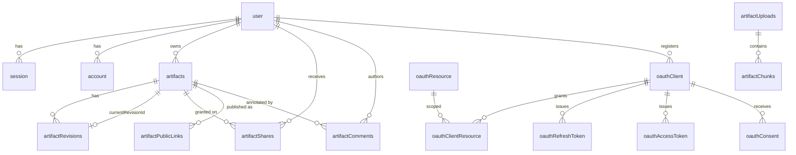

# Data model

PostgreSQL is the control plane. It stores identity, OAuth state, artifact
metadata, permissions, public-link hashes and comments. Artifact **bytes are never
stored in PostgreSQL**; only each revision's storage key (`artifacts/<revision id>`) and
its digest are.

Migrations live in `drizzle/` and are generated from three schema inputs:

- `apps/api/src/db/schema.ts` — Better Auth core
- `apps/api/src/db/oauth-schema.ts` — OAuth provider + JWT
- `apps/api/src/db/artifact-schema.ts` — product tables

`apps/api/src/db/auth-schema.ts` merges the auth + OAuth tables for the runtime
adapter; it is not a fourth generator input.

## 1. Entity relationships

Cardinality is enforced by foreign keys. Two pointers need attention:

- `artifacts.currentRevisionId` → `artifactRevisions.id` with `ON DELETE SET NULL`.
  It is a one-way FK declared lazy to avoid a circular type; revisions point back
  to the artifact with `ON DELETE CASCADE`.
- `artifactRevisions.storageKey` is **not declared unique**: one key belongs to exactly
  one revision by construction. The key is generated per revision before the byte write,
  is never derived from the digest and is never reused, so no two rows name the same
  object. The index stays because the orphan sweep looks keys up by value.
- `artifactPublicLinks.rotatedFromId` is a nullable self-reference
  (`ON DELETE SET NULL`) that chains a successor to its predecessor.
- `artifactUploads` is **not** linked to `artifacts` by a foreign key. Uploads are
  owner-scoped staging sessions; they become an artifact only at commit, when the
  artifact id is supplied or generated. This keeps an abandoned upload from
  blocking or referencing an artifact row.

## 2. Auth tables (Better Auth)

| Table          | Purpose                   | Notes                                                                             |
| -------------- | ------------------------- | --------------------------------------------------------------------------------- |
| `user`         | Accounts                  | `id` is a 32-char random text id; `email` unique (case-sensitive).                |
| `session`      | Browser sessions          | `token` unique; `expiresAt`; `userId` indexed; cascade on user delete.            |
| `account`      | Provider credentials      | `(providerId, accountId)` unique; stores password hash and OAuth provider tokens. |
| `verification` | Email/verification tokens | Present for Better Auth compatibility; no email provider is configured.           |

## 3. OAuth tables (`@better-auth/mcp` + JWT plugin)

| Table                  | Purpose                                                                         |
| ---------------------- | ------------------------------------------------------------------------------- |
| `oauthClient`          | Dynamic/registered clients, redirect URIs, auth method, PKCE policy, ownership. |
| `oauthResource`        | The protected resource (`<origin>/mcp`), allowed scopes and signing policy.     |
| `oauthClientResource`  | Client↔resource grant; unique pair.                                             |
| `oauthRefreshToken`    | Revocable credential with rotation/replay metadata; 14-day TTL.                 |
| `oauthAccessToken`     | Issued access tokens (metadata; the token is a JWT); 900-second TTL.            |
| `oauthConsent`         | Recorded user consent per client/resource/scopes.                               |
| `oauthClientAssertion` | Single-use `private_key_jwt` guard keyed by assertion digest.                   |
| `jwks`                 | Signing keys served at `/api/auth/jwks`.                                        |

## 4. Product tables

### `artifacts`

| Column                   | Type               | Meaning                                                                  |
| ------------------------ | ------------------ | ------------------------------------------------------------------------ |
| `id`                     | text PK            | Canonical lowercase UUID for new artifacts; legacy rows may be non-UUID. |
| `ownerId`                | text FK → user     | Cascade on account delete.                                               |
| `title`                  | text nullable      | Display title; not part of the content hash.                             |
| `currentRevisionId`      | text FK → revision | CAS pointer. `NULL` only in malformed/legacy states.                     |
| `observedSizeBytes`      | int nullable       | Committed size of the current revision (≤ 16 MiB).                       |
| `kind`                   | text               | `html` (default) or `markdown`; CHECK-enforced.                          |
| `deletedAt`              | timestamptz        | Soft delete; all delivery filters test it.                               |
| `createdAt`, `updatedAt` | timestamptz        | Audit timestamps.                                                        |

Indexes: `artifacts_ownerId_idx`. Checks: size cap, kind enum.

### `artifactRevisions`

| Column       | Type        | Meaning                                                   |
| ------------ | ----------- | --------------------------------------------------------- |
| `id`         | text PK     | Revision id (UUID).                                       |
| `artifactId` | text FK     | Cascade with the artifact.                                |
| `revision`   | int         | Monotonic per artifact; `(artifactId, revision)` unique.  |
| `sizeBytes`  | int         | Verified body size (≤ 16 MiB).                            |
| `sha256`     | text        | Lowercase 64-hex digest, CHECK-enforced.                  |
| `storageKey` | text        | `artifacts/<revision id>`; indexed; one key per revision. |
| `createdAt`  | timestamptz | Append time.                                              |

### `artifactUploads` and `artifactChunks`

| Table             | Columns                                                                                                                                            | Invariants                                                                                          |
| ----------------- | -------------------------------------------------------------------------------------------------------------------------------------------------- | --------------------------------------------------------------------------------------------------- |
| `artifactUploads` | `id` (client-supplied text PK), `ownerId`, `declaredSizeBytes`, `declaredSha256`, `expiresAt`, `status` (`open`/`complete`/`aborted`), `createdAt` | Client id makes retries idempotent; `expiresAt` is created with a 60-minute interval; status CHECK. |
| `artifactChunks`  | `id` (uuid PK), `uploadId` FK cascade, `chunkIndex`, `sizeBytes`, `sha256`, `createdAt`                                                            | `(uploadId, chunkIndex)` unique; size ≤ 1 MiB; digest CHECK.                                        |

The staging tables store **claims**, not content. The whole-artifact digest is
verified against real bytes during commit; per-chunk digests are computed by the
server from the received bytes.

### `artifactShares`

| Column             | Type           | Meaning                                           |
| ------------------ | -------------- | ------------------------------------------------- |
| `id`               | uuid PK        | Server-generated.                                 |
| `artifactId`       | text FK        | Cascade.                                          |
| `sharedWithUserId` | text FK → user | Recipient; cascade.                               |
| `grantedByUserId`  | text FK → user | Who granted; cascade.                             |
| `role`             | text           | `reader` (default), `editor`, `commenter`; CHECK. |
| `createdAt`        | timestamptz    |                                                   |

`(artifactId, sharedWithUserId)` unique makes a repeated grant idempotent at the
database level. A grant is addressed by the recipient's registered email; a self
grant is refused before insert.

### `artifactPublicLinks`

| Column          | Type                  | Meaning                                                   |
| --------------- | --------------------- | --------------------------------------------------------- |
| `id`            | uuid PK               | Server-generated.                                         |
| `artifactId`    | text FK               | Cascade.                                                  |
| `tokenHash`     | text                  | `sha256(token)`, unique and CHECK-enforced lowercase hex. |
| `revokedAt`     | timestamptz nullable  | Revocation timestamp; row retained for provenance.        |
| `rotatedFromId` | uuid nullable self-FK | Predecessor in a rotation chain.                          |
| `createdAt`     | timestamptz           |                                                           |

No expiry column: links live until revoked, by product decision. The raw token is
never stored, logged or returned after creation.

### `artifactComments`

| Column                   | Type                    | Meaning                                                                                                                                                                                                                                                                                                                         |
| ------------------------ | ----------------------- | ------------------------------------------------------------------------------------------------------------------------------------------------------------------------------------------------------------------------------------------------------------------------------------------------------------------------------- |
| `id`                     | uuid PK                 | Server-generated.                                                                                                                                                                                                                                                                                                               |
| `artifactId`             | text FK                 | Cascade.                                                                                                                                                                                                                                                                                                                        |
| `authorId`               | text FK → user          | Cascade.                                                                                                                                                                                                                                                                                                                        |
| `parentId`               | uuid nullable self-FK   | `NULL` = root; replies cascade with parent.                                                                                                                                                                                                                                                                                     |
| `anchor`                 | jsonb nullable          | Discriminated anchor, roots only: `text-range` {`startLine`, `startCol`, `endLine`, `endCol` (1-indexed, end-exclusive), `quotedText` ≤ 2,000 chars}, `element`, `page-point`, `board-point`, `slide-point`. Kind must match the document kind (markdown → `text-range`; html → `element`, `page-point`). Replies carry `NULL`. |
| `revisionId`             | text nullable FK        | Revision current when the root thread was created.                                                                                                                                                                                                                                                                              |
| `resolvedBy`             | text nullable FK → user | Who resolved the thread; cleared on unresolve.                                                                                                                                                                                                                                                                                  |
| `body`                   | text                    | Nonblank comment body (≤ 4,000 chars).                                                                                                                                                                                                                                                                                          |
| `resolvedAt`             | timestamptz nullable    | Roots only.                                                                                                                                                                                                                                                                                                                     |
| `createdAt`, `updatedAt` | timestamptz             |                                                                                                                                                                                                                                                                                                                                 |

Anchors are source-based, not DOM-based, so a comment survives formatting
normalization and degrades visibly to “outdated” instead of silently reattaching.

## 5. Cross-cutting invariants

1. **Ownership first.** Every read and write filters by `ownerId` (or by a live
   grant) before doing anything else. A foreign row is indistinguishable from a
   missing row.
2. **Soft delete is a delivery filter, never a cascade.** `deletedAt` is tested in
   every listing, viewer and lookup. Shares and links may remain; they grant
   nothing while the artifact is deleted.
3. **Digests are verified, not trusted.** CHECK constraints reject malformed
   digests at rest; every read re-hashes the bytes and compares them with the
   `sha256` stored on the revision row, because the key name no longer carries the
   digest.
4. **Caps live in the schema module.** `MAX_ARTIFACT_BYTES`, `MAX_CHUNK_BYTES`,
   `STAGING_TTL_MINUTES`, comment caps and kind/role enums are imported by the
   application and asserted against the generated SQL by tests.
5. **A live revision always has its object.** Bytes are written before the revision
   row that names them, the key belongs to exactly one revision and is never reused,
   and a restore copies the bytes under a fresh key before inserting its own row.
   Two rows therefore never share a key by construction, so deleting one artifact's
   keys cannot remove another revision's bytes.
6. **CAS for concurrency.** `currentRevisionId` is the optimistic lock. A stale
   `expectedRevisionId` yields `concurrent_commit`/`concurrent_edit` with the
   current pointer; nothing is overwritten.

## 6. Retention and lifecycle

| Object                   | Lifecycle                                                                                                                                           |
| ------------------------ | --------------------------------------------------------------------------------------------------------------------------------------------------- |
| Upload / chunks          | Rows deleted after expiry (or terminal status) once chunk bytes resolve; staging bytes collected by the GC.                                         |
| Revision                 | Immutable; grows only by appends.                                                                                                                   |
| Artifact                 | Soft delete only. Rows and revision metadata are retained indefinitely.                                                                             |
| Deleted artifact's bytes | Removed best effort with the artifact's own keys once the soft delete commits; a refused delete leaves bytes its retained revision rows still name. |
| Public link              | Revoked rows retained; tokens hashed.                                                                                                               |
| Comment                  | Hard delete; deleting a root cascades replies.                                                                                                      |

There is no hard-delete job for artifacts, and no retention policy for old
revisions.

Unreferenced revision bytes are reclaimed by a daily in-process sweep; the delete
path removes an artifact's own keys when it can. The sweep removes only keys under
`artifacts/` that no `artifactRevisions` row names and whose provider-reported
`LastModified` is older than a 24-hour grace window, so an object written just before a
crash between the put and the row write is not collected while the commit could still
complete. It never writes, updates or deletes a row, it examines at most 2,000 keys per
run in pages of 200 without persisting a cursor, and it runs once shortly after startup
and then once a day.

Two consequences worth stating: dropping deduplication does not change the storage
growth story (identical bytes are rare, so the sharing it removed saved little), and a
soft-deleted artifact's rows stay, so bytes whose best-effort delete is refused are not
picked up by the sweep either — nothing reclaims them until a hard delete exists.
