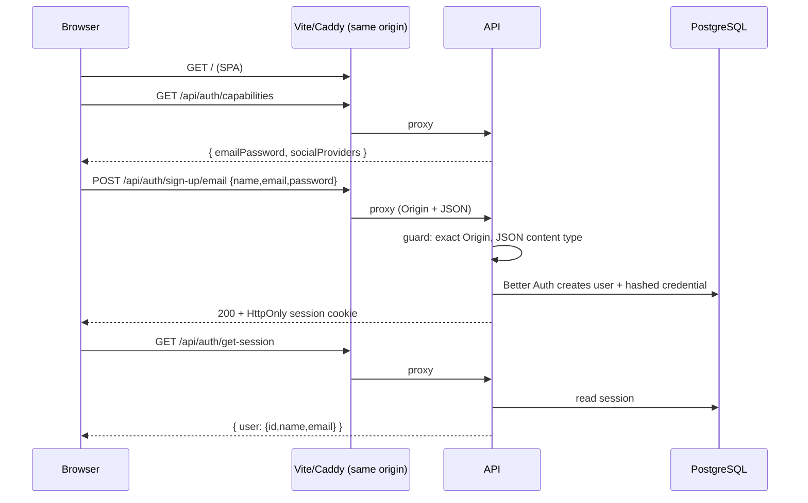
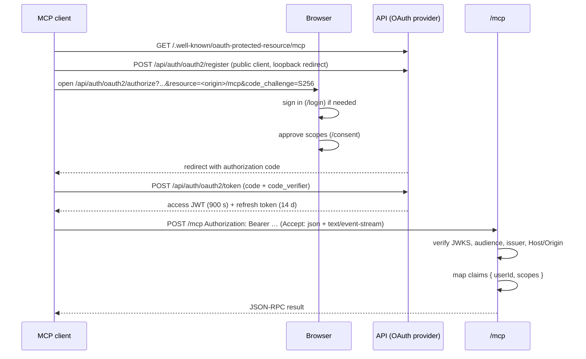
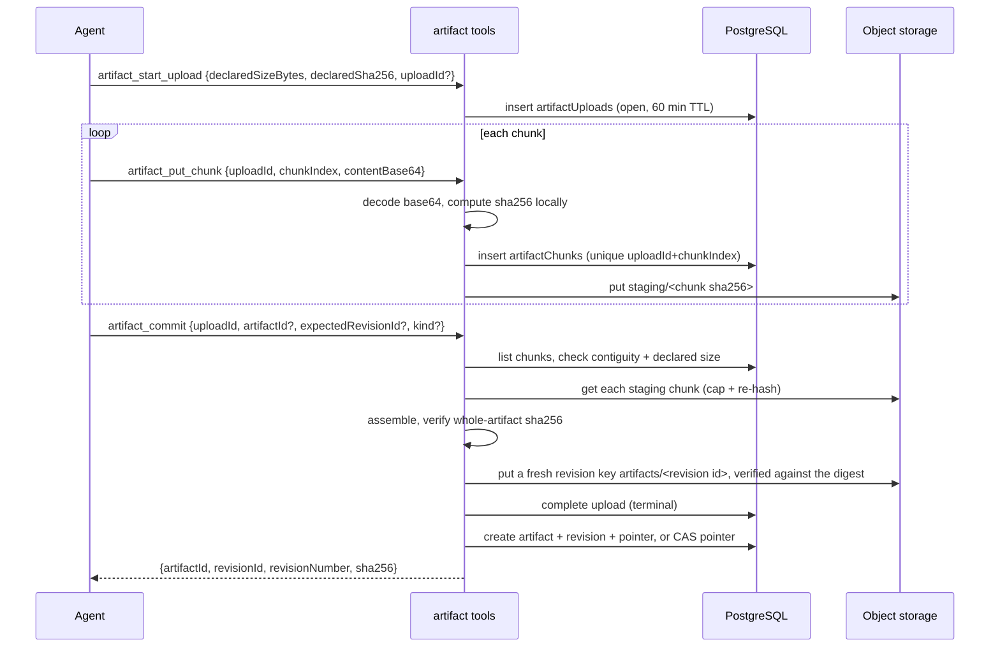
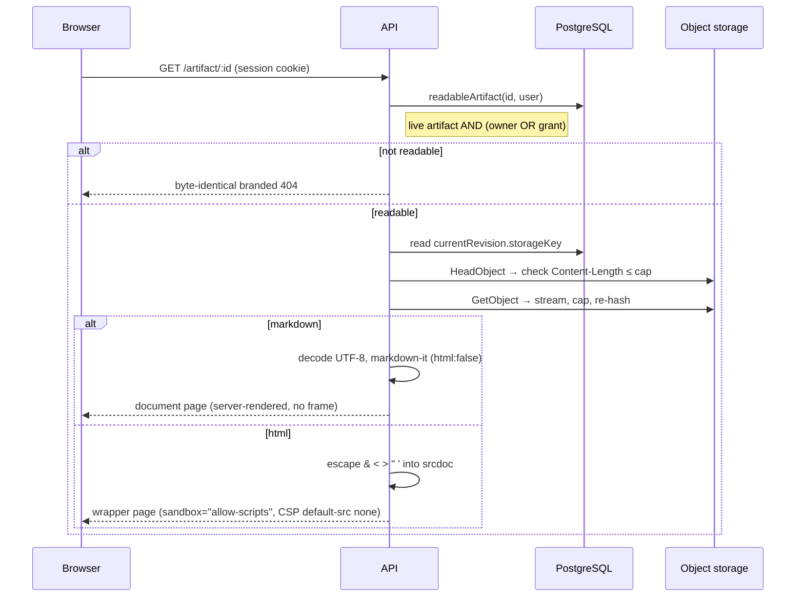

# Key flows

Each flow below is grounded in the modules named at the end. The goal is that an
engineer can trace a request end to end without opening every file.

## 1. Startup and configuration

1. `server.ts` calls `loadConfig(process.env)` once. A `ConfigError` prints a
   redacted reason and exits with code 1.
2. It creates the PostgreSQL pool (`createDatabase`) and the S3 client
   (`createStorage`), then builds the Better Auth instance and mounts every app.
3. `startStagingGcLoop` and `startRevisionGcLoop` schedule their sweeps (15 s and
   60 s after start, then every 15 minutes and once a day; unref'd timers, one sweep
   at a time).
4. On `SIGINT`/`SIGTERM`: stop accepting connections, stop both GC sweeps, close the pool,
   destroy the S3 client. Shutdown is idempotent.

Modules: `config.ts`, `db/client.ts`, `storage/client.ts`, `auth.ts`, `server.ts`,
`artifacts/gc.ts`.

## 2. Browser sign-up / sign-in



The SPA treats a 200 from a mutation as unproven until `get-session` confirms the
identity. Passwords and tokens are never stored in `localStorage`.

Email/password is enabled when `NODE_ENV=production`, or in development when
`ARTIFLOW_DEMO_AUTH=1` **and** the public origin is loopback.

## 3. MCP OAuth and a tool call



Rules that make this safe:

- Authorize refuses a missing `resource` before the provider runs.
- Dynamic registration grants no access; the human consent is the gate.
- `/mcp` accepts only `Authorization`; a dashboard cookie alone gets the RFC 9728
  challenge.
- Refresh tokens rotate strictly; a replay revokes the family. Access tokens are
  self-contained and live until expiry.

Modules: `oauth.ts`, `auth.ts`, `mcp.ts`, `artifact-tools.ts`.

## 4. Publish an artifact over MCP



Failure semantics are ordered:

- A preflight refusal writes nothing (upload stays retryable).
- A storage failure leaves no revision row and bytes no row names, which the daily
  revision sweep collects once they are older than its 24 h grace window.
- A losing CAS returns `concurrent_commit` with the current revision id; the client
  retries against it.
- A digest mismatch stores no artifact row.

A write either names the revision it was built from (`expectedRevisionId`) or names none, and
only those two forms exist: with the id it is compare-and-set, so a moved pointer refuses instead
of overwriting; without it the write is create-or-refuse, so a second `artifact_write` or
`artifact_commit` for an existing artifact id also refuses rather than replacing its head. There is
no last-writer-wins path. Recovery is a re-read, not a retry: take the current revision id the
refusal returned (or read it with `artifact_get`), rebuild the write on top of the content that id
names, then write once more. Replaying the same `expectedRevisionId` after a refusal keeps
refusing, which is why the current pointer is part of the reply.

Modules: `artifact-tools.ts`, `artifacts/staging.ts`, `artifacts/s3.ts`,
`artifacts/commit-flow.ts`, `artifacts/commits.ts`.

## 5. Open an artifact (owner or recipient)



The same wrapper and CSP are used by the public link path
(`GET /share/:token`), which resolves `sha256(token)` against a live link and a
live artifact. A miss is always the same 404 page.

Modules: `library.ts`, `sharing.ts`, `viewer/prepare.ts`,
`viewer/views/{html,markdown,scene}.ts`, `artifacts/s3.ts`.

## 6. Share by email and public links

**Share grant**

1. Owner session + exact Origin + JSON.
2. The API verifies the artifact is live and owned by the caller.
3. The recipient email is normalized and resolved to a registered account
   (case-insensitive). Unknown email → `404 recipient_not_found`; self-share →
   `400 invalid_recipient`.
4. Insert the grant; `UNIQUE(artifactId, sharedWithUserId)` arbitrates races.
5. The recipient sees it under “Shared with me” and can read/view; a reader cannot
   write or comment. Revocation deletes the row.

**Public link**

1. Generate 32 random bytes → 43-char base64url token; store only `sha256(token)`.
2. Return the URL and raw token once; it is never logged or stored again.
3. Revoke stamps `revokedAt`; rotate inserts a successor and revokes the
   predecessor in one transaction, preserving the chain.
4. The public viewer is session-free and adds `x-robots-tag: noindex`.

Modules: `sharing.ts`, `viewer/prepare.ts`, `viewer/views/{html,markdown,scene}.ts`.

## 7. Markdown editing (browser)

```mermaid
sequenceDiagram
  participant B as Browser (TipTap)
  participant A as API
  participant DB as PostgreSQL
  participant S3 as Object storage

  B->>A: GET /api/artifacts/:id/document
  A->>DB: gate: live artifact + owner/role + kind=markdown + current revision
  A->>DB: read the draft, else the current snapshot
  A->>S3: snapshot path: read + verify bytes
  A-->>B: { text, revisionId, revisionNumber, seq, publishedSeq }
  Note over B: user edits; autosave debounces 1.5 s
  B->>A: PUT /document { text, expectedSeq }
  A->>A: guard Origin+JSON; editor role required
  A->>A: expectedSeq with expectedRevisionId → 400 unexpected_revision_token
  A->>DB: no expectedSeq: a draft row → 409 sequence_required { currentSeq, currentRevisionId }
  A->>A: expectedSeq ≠ draft seq → 409 concurrent_edit { currentSeq, currentRevisionId }
  A->>A: diff the stored text against the submitted text into typed operations
  A->>DB: one transaction: append the operation row + advance the draft sequence
  opt 100 operations or ten minutes since the last snapshot
    A->>S3: putRevisionBytes of the canonical draft (digest-verified)
    A->>DB: one transaction: insert snapshot N+1 + move publishedSeq and the pointer
  end
  A-->>B: { revisionId, revisionNumber, seq, publishedSeq }
```

The save names exactly one identity: `expectedSeq` writes the draft, and a save without
it is the whole-revision path, which only an artifact the operation path never touched
(a draftless one) still accepts, gated by `expectedRevisionId`. Naming both is a 400, so
no client can believe two identities protect the same write, and every `concurrent_edit`
refusal carries the same `{ currentSeq, currentRevisionId }` payload.

Version history is read-only; **restore** reads a pinned revision's verified bytes and
records them as a `replace_document` operation plus a _new_ snapshot, so undo is itself
undoable and the operation log records who restored what. It refuses with
`409 restore_pending_changes` (carrying `currentSeq`) while the draft holds applied
operations that are not published yet, because publishing over them would destroy them.
The operation row, the snapshot, `publishedSeq`, the pointer and the draft move in one
transaction or not at all: a restore that loses the race writes nothing but the object
bytes, which the revision sweep collects because no row names them.
A conflict freezes autosave and keeps local edits until the user reloads explicitly.

Modules: `editing.ts`, `documents/service.ts`, `documents/commit-flow.ts`,
`artifacts/s3.ts`, `web/editor-api.ts`, `web/editor-autosave.ts`.

## 8. Comments on a source selection

1. The UI maps a TipTap selection to 1-indexed source line/UTF-16 columns and
   renders the source slice as the `quotedText` of a `text-range` anchor.
2. `POST /api/artifacts/:id/comments` locks the artifact row (`FOR UPDATE OF a`),
   re-reads the **current** revision after the lock, validates the discriminated
   anchor against the document kind, verifies the anchor and the exact quote,
   checks that the root's `expectedRevisionId` is that revision, then inserts
   with that revision id. A root comment names the revision its writer was
   looking at: both owner viewers ship the served revision id in the comment
   config (the public one ships none, since it cannot write), the editor sends
   the revision it was last saved against, and a page that has been republished
   since is refused instead of landing on text nobody saw. Replies carry no
   anchor and no revision of their own.
3. A stale quote → `400 anchor_mismatch`; invalid range or malformed anchor →
   `400 invalid_anchor`; an anchor kind the document kind does not accept →
   `400 unsupported_anchor_kind`; a root without an anchor → `400
root_requires_anchor`; a reply carrying an anchor → `400 reply_has_no_anchor`;
   a root that names no revision → `400 expected_revision_required`; a root whose
   `expectedRevisionId` is not the current revision → `409 revision_conflict` and
   nothing is inserted.
4. Replies store only a body and inherit their context from the root; replies to
   replies are refused. Resolve/unresolve affects roots only and records
   `resolvedBy`.
5. Deleting a root cascades replies in the database.

Comments never create revisions. A reader sees the threads and is refused every write with
`403 forbidden`. HTML documents accept `element` and `page-point` anchors, which the server validates
for shape only and the client positions; Markdown keeps `text-range`. For the kinds that mount a
margin — pages and docs — a public link serves its threads read-only through
`GET /share/:token/comments` only while the link's `showComments` option is on, with authors reduced
to `{ id, name, image }`. A canvas or a deck mounts no margin: it shows its threads as pins inside the
frame on the owner page, a public scene link ships no pin and no comment surface at all, and the
endpoint refuses a scene link with the same `404 not_found` it answers for a token that names nothing,
so the answer never tells a reader what kind the token serves. For those kinds the
option also decides whether the public page mounts it: the same URL with `?meta=1` answers
JSON instead of the page, carrying `kind`, `revisionNumber`, `sha256`, `sizeBytes` and
`comments`, the effective flag. That flag is false for canvas and deck whatever the link says,
and a page served with it off ships no comment host, config or bundle. The public poller reads
that flag on every tick, so turning the option off reloads an open page once — the margin, its data
island and its bundle are server-emitted, and the viewer contract rebuilds the document by reload
only.

HTML documents accept `element` anchors, and the bridge injected into the viewer frame resolves them by
`id`, then a `data-*` attribute, then a unique text hint, falling back to the stored `page-point` and a
dashed pin labelled "Element changed" when nothing matches uniquely. Pins are drawn inside the frame
so they follow inner scroll, sticky elements and animations; the parent owns the margin, and no comment
text ever crosses the bridge.

The thread margin is a 360px column on the editor and both viewers. Closed threads are compact pills
aligned with their anchors (author avatar and reply count, or a check mark once resolved); opening one
shows a dock beside the pills, sticky 12px from the top of the visible area, with a `Thread i of n`
header and previous/next/close, a scrollable body and an always-visible footer with the reply form and
Resolve or Reopen and Delete. A new selection or picked element opens its draft in the dock and shows
a ghost pill at the anchor. Threads without a location are listed in the dock area while no thread is
open, so they stay reachable in the HTML viewer, whose column cannot scroll. The bridge posts the
frame's scroll position once on ready and on load, so a frame that opens already scrolled places the
pills correctly.

Below 800px the pills hide and the same dock content opens as a bottom sheet (thread header with
previous/next/close, replies, Resolve or Reopen, Delete, and a reply form kept in a sticky footer; new
drafts open there too), reached from an `Open threads` button in the comments bar, which stays visible as
a collapsed row. In the editor and both Markdown surfaces `J` and `K` move to the next or previous
thread in document order (without wrapping), `R` focuses the open thread's reply box and `Esc` closes the
open thread or draft. Keystrokes inside the sandboxed artifact frame belong to the artifact and never
reach the page, so the HTML viewer is navigated from its pills and the `Open threads` control. Shortcuts
are ignored while typing (including in the editor), with modifier keys held, during an IME composition,
while comments are hidden, and while focus sits on a control that owns the key (toolbar buttons, links,
menu items), where `Esc` also belongs to that control. A `#c-<threadId>` link opens that thread on load
and on `hashchange`, revealing the comments column if the reader had hidden it, and scrolling the anchor
into view (instantly under reduced motion; the HTML viewer uses the bridge `focus` command); opening a
thread rewrites the hash with `replaceState` and closing it clears it. Unknown ids are ignored.

The shared and public Markdown viewers render the sanitized fragment in the page itself and mount the
same thread margin from a dedicated `viewer-comments` bundle, receiving an already-authorized JSON data
island (`apps/api/src/viewer/comments-data.ts`) with each thread's staleness and text occurrence. The
HTML viewer keeps its sandboxed frame.

A viewer never trades the document for its comments: if the comment store fails while rendering, the
page is served without threads, writing is disabled and the failure is logged. The frame bridge accepts
a bounded rate of messages per time window, so a long session does not run out of budget, and a failed
write keeps the draft and the error visible for a retry.

Agents read a source window with `artifact_get_markdown`, quote or anchor the exact text that
window returned, and comment on it. A comment never moves: the row keeps the `anchor` recorded at
creation (for markdown a `text-range` anchor with its coordinates and `quotedText`), while the
document head may have been edited since.
Staleness is detected by comparing the current source at those recorded coordinates with the stored
quote, so an outdated thread stays at its anchor and is labelled outdated instead of being relocated
to a guessed position, and comments that now look alike (the same rendered quote after an edit, two
replies with the same body) stay distinct rows. Both are explicit uncertainty for the reader to
resolve against the document, never a silently corrected view; the write side matches that, refusing
a new root comment with `anchor_mismatch` unless its quote still matches the current source exactly.
No comment edit, no lifecycle beyond resolve/unresolve, no anchor relocation and no comment migration
exist or are implied here.

Modules: `comments.ts`, `artifact-tools.ts`, `web/comment-anchors.ts`,
`web/components/comments/comment-thread-margin.tsx`, fed by
`web/components/comments/markdown-comments.tsx`.

## 9. Delete and garbage collection

**Delete (owner, confirmed twice)**

1. Cookie + Origin + JSON; non-UUID/missing/foreign/already-deleted → one 404.
2. Stamp `deletedAt` (idempotent). This is the whole answer: the artifact stops
   resolving everywhere immediately.
3. Best-effort: delete the artifact's own revision keys, one per revision and never
   shared with another artifact, so no reference query is needed. A storage failure is
   swallowed (the owner's intent was already honoured) and leaves bytes the revision
   sweep will not collect either, because the retained rows still name them.

**Staging GC (every 15 min)**

1. Snapshot expired non-complete uploads and their digests **before** deleting rows
   (the cascade would erase the digest→key mapping).
2. Compute digests claimed by terminal uploads, excluding any digest still needed
   by an open, unexpired upload.
3. Delete `staging/<sha256>` per key, isolating failures; only then delete expired
   upload rows whose digests all resolved.
4. Revision bodies under `artifacts/` are never touched; they have their own sweep.

**Revision orphan sweep (daily)**

1. List `artifacts/` in pages of 200, at most 2,000 keys per run, with no persisted
   cursor: each run restarts from the beginning of the listing.
2. An object is a candidate only when the provider's `LastModified` is older than 24 h
   **and** no `artifactRevisions` row names its key; one row query per page, never one
   per key.
3. Delete the candidates one by one, isolating failures. The sweep writes no row: its
   only effect is removing bytes no revision names.

Modules: `deletion.ts`, `artifacts/gc.ts`, `artifacts/s3.ts`.

## 10. Health and degradation

`GET /api/health` runs `SELECT 1` and `HeadBucket` in parallel:

- both pass → `200 {"status":"ok"}`
- either fails → `503 {"status":"degraded"}`
- response bodies carry only `ok`/`error`, never connection details.

Auth and metadata continue to work while storage is degraded; commits and reads
fail closed. The production API container uses this endpoint as its healthcheck.

Modules: `health.ts`, `server.ts`.
