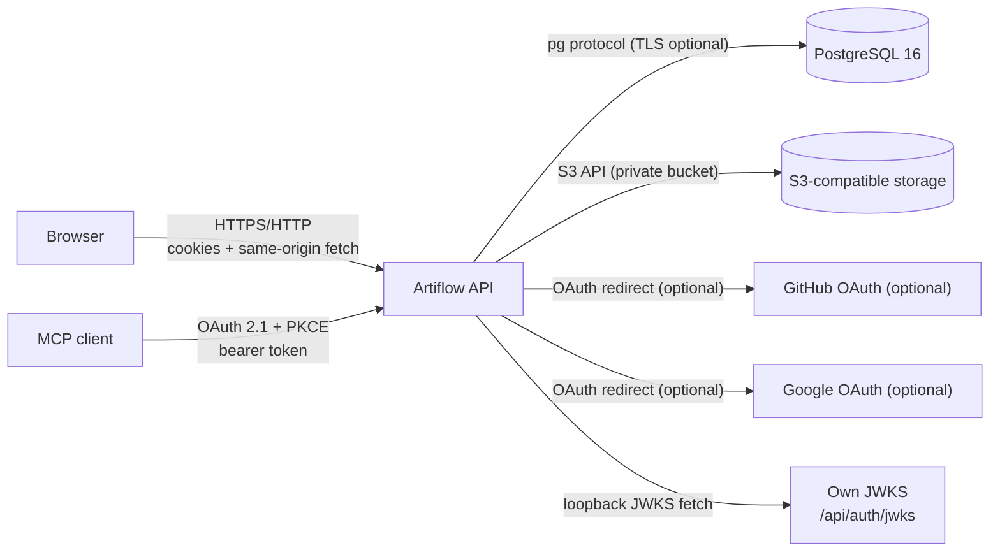

# Integrations and external services

Artiflow integrates with very few external systems on purpose. Everything that
can be embedded is embedded: authentication is a library, not a service, and the
only network dependencies at runtime are PostgreSQL and S3-compatible storage.

## 1. Dependency graph

## 2. Services and technologies

### PostgreSQL 16

- **Role:** control plane. Users, sessions, OAuth clients/tokens/consents,
  artifacts, revisions metadata, upload claims, shares, public-link hashes, comments.
- **Client:** `pg` 8.23 pool (max 4 connections, 3 s connect timeout, 10 s idle
  timeout, application name `artiflow-local-api`).
- **ORM:** Drizzle 0.45 for the auth adapter and migrations; product tables are
  defined in Drizzle but currently queried with typed `pg` SQL. Unifying them is
  planned.
- **Deployment:** always external. Point `DATABASE_URL` at a PostgreSQL 16 server
  and role you control; the repository never starts, creates or provisions it.
  Add `sslmode` when the server requires TLS.
- **Schema ownership:** migrations in `drizzle/`, tracking table
  `drizzle.__drizzle_migrations`. The app owns its tables, not the server.
- **Health:** `SELECT 1`.

### S3-compatible object storage

- **Role:** data plane. Immutable bytes only.
  - `staging/<sha256>` — one staged chunk (≤ 1 MiB).
  - `artifacts/<revision id>` — one revision body (≤ 16 MiB), one key per revision.
- **Client:** `@aws-sdk/client-s3` 3.1152; path-style defaults on for loopback
  endpoints and is configurable for external providers.
- **Deployment:** always external. Any private S3-compatible bucket works
  (Cloudflare R2, AWS S3, MinIO, Ceph, …). The bucket and credentials exist
  before the app starts; the repository never creates them.
- **Path style:** `ARTIFLOW_S3_FORCE_PATH_STYLE=1` for R2 and most non-AWS
  providers.
- **Security:** the bucket must be private; the app requests no ACL or bucket
  policy and never exposes a public object URL.
- **Health:** `HeadBucket`.
- **Integrity:** the key does not name the digest. Every read checks `Content-Length`
  against the cap, hashes the stream and compares it with the `sha256` stored on the
  revision row, refusing a mismatch.

### Better Auth 1.7.10 (embedded)

- **Role:** email/password and optional social sign-in, session cookies, and the
  OAuth 2.1 authorization server used by MCP.
- **Plugins:** `jwt()` (issuer `<origin>/api/auth`) and `mcp()` (OAuth provider,
  dynamic client registration, consent, scopes, refresh rotation).
- **No telemetry, no logger, no cookie cache.** Sessions always re-read from the
  database.
- **Providers:** email/password; GitHub and Google only when both credentials are
  present. No email delivery is configured.
- **Endpoints:** `/api/auth/*`, `/api/auth/capabilities`, `/api/auth/jwks`,
  `/.well-known/oauth-*`.

### Model Context Protocol SDK 1.32

- **Transport:** Streamable HTTP at `/mcp`, stateless (one transport + server per
  POST, no session id, `GET`/`DELETE` → 405).
- **Auth:** `@better-auth/mcp` `requireMcpAuth` verifies bearer tokens against the
  local JWKS at `http://127.0.0.1:<port>/api/auth/jwks`, with the audience
  `<origin>/mcp` and issuer `<origin>/api/auth`.
- **Deployment assumption:** the API must reach itself over loopback HTTP on the
  configured port. The loopback authority is also added to the `Host` allowlist.
  A proxy that rewrites `Host` to `api:8787`, a Unix socket, or a runtime without
  loopback HTTP will break MCP verification. This hardcode is a known deployment
  constraint.
- **Guard:** DNS-rebinding protection with exact `Host` and `Origin` allowlists.
- **Scopes:** `artifacts:read`, `artifacts:write`, `offline_access`.

### Frontend stack

- React 19 + Vite 8 + Tailwind 4, Radix primitives, TipTap for markdown,
  markdown-it 15 for server-side rendering.
- The SPA makes only same-origin calls. There is no third-party runtime API, no
  analytics, no font CDN (Geist is bundled via `@fontsource-variable`).

### Edge

- **Development:** Vite proxy routes `/api`, `/mcp`, `/.well-known`, `/share`,
  `/artifact` to `http://127.0.0.1:8787`.
- **Production:** Caddy 2 terminates TLS, serves the built SPA from `/srv`, and
  reverse-proxies the same paths to `api:8787`.
- **Landing:** the mock `site/` build is removed; a web workspace for the site and
  docs is planned and not part of the app image.

## 3. Ports

| Port   | Profile | Service                                        |
| ------ | ------- | ---------------------------------------------- |
| 5173   | dev     | UI (Vite), public entry                        |
| 8787   | dev     | API (Hono), loopback                           |
| 80/443 | prod    | Caddy (TLS + SPA + proxy)                      |
| 8787   | prod    | API, internal network only (no published port) |

PostgreSQL and object storage are external. Their ports are defined by your
provider, not by this repository.

## 4. Environment contract

Configuration is validated once at startup in `apps/api/src/config.ts`. Invalid values
fail the process with the variable **name** only; values are never logged.

| Variable                                                                | Required | Default                 | Notes                                                        |
| ----------------------------------------------------------------------- | -------- | ----------------------- | ------------------------------------------------------------ |
| `NODE_ENV`                                                              | no       | `development`           | `development` \| `production` \| `test`                      |
| `ARTIFLOW_API_HOST`                                                     | no       | `127.0.0.1`             | Only `127.0.0.1` or `0.0.0.0`                                |
| `ARTIFLOW_API_PORT`                                                     | no       | `8787`                  | Integer 1–65535                                              |
| `ARTIFLOW_PUBLIC_ORIGIN`                                                | no       | `http://127.0.0.1:5173` | Bare origin, no path/query                                   |
| `ARTIFLOW_DEMO_AUTH`                                                    | no       | off                     | `1`; only with `NODE_ENV=development` and a loopback origin  |
| `ARTIFLOW_AUTH_SECRET`                                                  | **yes**  | —                       | ≥ 32 characters                                              |
| `ARTIFLOW_AUTH_GITHUB_CLIENT_ID` / `ARTIFLOW_AUTH_GITHUB_CLIENT_SECRET` | pair     | —                       | Both or neither                                              |
| `ARTIFLOW_AUTH_GOOGLE_CLIENT_ID` / `ARTIFLOW_AUTH_GOOGLE_CLIENT_SECRET` | pair     | —                       | Both or neither                                              |
| `DATABASE_URL`                                                          | **yes**  | —                       | `postgres://` or `postgresql://`                             |
| `ARTIFLOW_S3_ENDPOINT`                                                  | **yes**  | —                       | Absolute http(s) URL                                         |
| `ARTIFLOW_S3_BUCKET`                                                    | **yes**  | —                       | Lowercase S3 name, 3–63 chars                                |
| `ARTIFLOW_S3_ACCESS_KEY_ID`                                             | **yes**  | —                       |                                                              |
| `ARTIFLOW_S3_SECRET_ACCESS_KEY`                                         | **yes**  | —                       |                                                              |
| `ARTIFLOW_S3_REGION`                                                    | no       | `us-east-1`             | `auto` for R2                                                |
| `ARTIFLOW_S3_FORCE_PATH_STYLE`                                          | no       | loopback-dependent      | `1`, `0`, or unset                                           |
| `ARTIFLOW_ALLOW_REMOTE_MIGRATE`                                         | no       | off                     | `1` required for any target outside the owned local database |
| `ARTIFLOW_API_PROXY_TARGET`                                             | no       | `http://127.0.0.1:8787` | Vite dev only                                                |
| `ARTIFLOW_SITE_ADDRESS`                                                 | prod     | —                       | Caddy site address, e.g. `artifacts.example.com`             |
| `API_UPSTREAM`                                                          | prod     | `api:8787`              | Caddy proxy upstream                                         |
| `ARTIFLOW_PROD_ENV_FILE`                                                | no       | `.env.prod`             | Compose env file path                                        |

Not supported on purpose: `PORT`, arbitrary bind addresses, a custom path prefix
behind a reverse proxy, multiple public origins.

## 5. Protocol contracts

| Contract         | Version/standard                                                                                 | Where                                  |
| ---------------- | ------------------------------------------------------------------------------------------------ | -------------------------------------- |
| MCP              | Streamable HTTP, one JSON-RPC message set per POST                                               | `apps/api/src/mcp.ts`                  |
| OAuth            | 2.1-style authorization code + PKCE S256, DCR (RFC 7591), protected-resource metadata (RFC 9728) | `apps/api/src/oauth.ts`, `auth.ts`     |
| Bearer challenge | RFC 6750 `insufficient_scope` with the required scope                                            | `artifact-tools.ts`                    |
| S3               | AWS S3 API, path-style                                                                           | `storage/client.ts`, `artifacts/s3.ts` |
| SQL              | PostgreSQL 16                                                                                    | `apps/api/src/db`                      |
| TLS              | Caddy automatic ACME in production                                                               | `docker/Caddyfile`                     |

## 6. Failure behaviour

| Dependency down          | Effect                                                                                                    |
| ------------------------ | --------------------------------------------------------------------------------------------------------- |
| PostgreSQL               | `/api/health` → 503; auth, listing, MCP tools fail; process stays up                                      |
| Object storage           | `/api/health` → 503; commit and reads fail with typed errors; auth and metadata still work                |
| Optional social provider | Provider absent at startup unless configured; a configured provider outage only affects that sign-in path |
| JWKS loopback            | MCP bearer verification fails; the browser and dashboard are unaffected                                   |

The API does not retry beyond SDK defaults, does not buffer bytes in memory beyond
one bounded artifact, and never silently succeeds on a storage failure.
